# Manual do Arruma

O Arruma põe ordem nas pastas do teu computador. Escolhes uma pasta (ou várias, ou o computador inteiro), ele vê o que lá está e propõe um plano: que ficheiros vão para onde, que pastas novas aparecem, que restos podem ir para o Lixo. Só depois de reveres e aprovares esse plano é que alguma coisa muda. O Arruma assenta em três promessas, as mesmas que vês no fundo da janela inicial: «Sem internet», porque nenhum ficheiro sai do computador; «Revês tudo antes», porque nada muda sem a tua aprovação; e «Sempre reversível», porque podes anular qualquer arrumação.

Este manual descreve a versão 0.2.2, para Linux Mint (serve também para Ubuntu e Debian), Windows 10 e 11 e macOS 15 ou mais recente. Começa pela instalação, segue com as mensagens que podem aparecer em cada sistema e acaba no que podes fazer em cada vista do Arruma.

## Índice

1. [Antes de começar](#antes-de-começar)
2. [Instalar](#instalar)
3. [Mensagens que podem aparecer](#mensagens-que-podem-aparecer)
4. [Atualizar, reinstalar e desinstalar](#atualizar-reinstalar-e-desinstalar)
5. [Usar o Arruma](#usar-o-arruma): [Início](#início), [Análise](#análise), [Plano](#plano), [Duplicados](#duplicados), [Histórico](#histórico), [Definições](#definições), [Acerca](#acerca)
6. [IA local e leitura de digitalizações (opcionais)](#ia-local-e-leitura-de-digitalizações-opcionais)
7. [Clique direito nas pastas](#clique-direito-nas-pastas)
8. [Problemas frequentes](#problemas-frequentes)
9. [Onde ficam os teus dados](#onde-ficam-os-teus-dados)

## Antes de começar

### O que precisas

| Sistema | Versão mínima | Palavra-passe de administrador | Ficheiro a descarregar |
|---|---|---|---|
| Linux | Linux Mint 21 ou Ubuntu 22.04 (o Arruma precisa do Python 3.10 ou mais recente) | Sim, na instalação normal; há uma alternativa sem ela | `arruma_0.2.2_all.deb` |
| Windows | Windows 10 ou 11 de 64 bits | Não, na instalação normal | `Arruma-0.2.2-windows-instalador.exe` (ou a versão portátil, `Arruma-0.2.2-windows-portatil.zip`) |
| macOS | macOS 15 (Sequoia) | Sim | `Arruma-0.2.2-macos-apple-silicon.pkg` ou `Arruma-0.2.2-macos-intel.pkg` |

O LMDE e o Debian 12 têm um Python que serve, mas o Arruma não foi testado neles. No Windows, a instalação ocupa cerca de 120 MB.

Nos nomes dos ficheiros, `0.2.2` é a versão. Se descarregares outra, troca o número nos comandos deste manual.

### Que Mac tenho?

Há dois instaladores para o Mac, e o certo depende do processador. Abre o menu Apple (a maçã no canto superior esquerdo do ecrã) e escolhe «Acerca deste Mac». Segundo a Apple, a janela mostra um elemento chamado «Processador», seguido do nome do processador. Se for um processador Apple (M1, M2, M3…), descarrega o instalador `apple-silicon`; se for um processador Intel, descarrega o `intel`.

Se te enganares, não acontece nada de mal. O instalador Intel num Mac com processador Apple diz «Este instalador é para Macs com processador Intel» e não continua; o instalador `apple-silicon` num Mac Intel é recusado pelo próprio macOS.

### Onde descarregar

Todos os ficheiros estão na página de versões do Arruma: <https://github.com/franciscovazquezreis/Arruma/releases>. A página está em inglês; os ficheiros de cada versão aparecem na lista «Assets», por baixo da descrição.

Descarrega só o ficheiro do teu sistema (a tabela acima diz qual). Ignora os dois ficheiros terminados em `codigo-fonte-terceiros-windows.tar` e `codigo-fonte-terceiros-macos.tar`: têm centenas de MB e não servem para instalar. Existem porque as licenças dos componentes de outros autores que vão dentro do Arruma obrigam a publicar o código. Os ficheiros «Source code (zip)» e «Source code (tar.gz)» só interessam para a [instalação sem palavra-passe no Linux](#só-para-ti-sem-palavra-passe-de-administrador).

## Instalar

### Linux Mint

Há três maneiras. A primeira, com o Terminal, é a recomendada. A segunda usa o duplo clique no ficheiro. A terceira instala o Arruma só para ti, sem palavra-passe de administrador.

#### Com o Terminal (recomendado)

Não precisas de saber usar o Terminal: basta copiar cada comando, colá-lo e carregar em Enter.

1. Abre o Terminal. Está no menu de aplicações; também o encontras escrevendo «Terminal» na pesquisa do menu.
2. Vai para a pasta Transferências:

   ```bash
   cd ~/Transferências
   ```

3. Descarrega o pacote. Se já o descarregaste no navegador (que o guarda em Transferências), salta este passo.

   ```bash
   wget https://github.com/franciscovazquezreis/Arruma/releases/download/v0.2.2/arruma_0.2.2_all.deb
   ```

4. Instala-o:

   ```bash
   sudo apt install ./arruma_0.2.2_all.deb
   ```

   O `./` antes do nome é obrigatório. Sem ele, o sistema procura um pacote com esse nome nos repositórios de software e não o encontra.

5. Quando aparecer `[sudo] senha para ana:` (com o teu nome de utilizador em vez de «ana»), escreve a palavra-passe com que entras no computador e carrega em Enter. No Linux Mint aparece um asterisco por cada letra que escreves.
6. Se o Terminal perguntar `Deseja continuar? [S/n]`, carrega em Enter.
7. Vão aparecendo linhas como `A ler as listas de pacotes... Feito` e `A instalar arruma (0.2.2) ...`. A instalação acabou quando o Terminal volta a mostrar a linha onde se escreve; o apt não escreve «concluído».
8. Abre o Arruma no menu de aplicações, em Acessórios → Arruma.

O `wget` e o `apt` precisam de internet, porque o apt pode ter de descarregar peças de que o Arruma depende. Depois de instalado, o Arruma trabalha sem ela.

**Se no passo 4 aparecer a linha `Pacotes recomendados:`**, o sistema deixou de fora alguns extras que o Arruma recomenda (no Linux Mint isso pode acontecer). Servem para ler a data e a câmara das fotografias, as etiquetas da música e os PDF digitalizados. O Arruma funciona sem eles, mas arruma melhor com eles. Instala-os assim:

```bash
sudo apt install python3-pil python3-mutagen librsvg2-common tesseract-ocr tesseract-ocr-por
```

#### Com duplo clique no ficheiro

1. Descarrega `arruma_0.2.2_all.deb` no navegador. Fica na pasta Transferências.
2. Abre essa pasta no gestor de ficheiros e faz duplo clique no ficheiro. Deve abrir-se o «Instalador de Pacotes» (no Linux Mint 22.1 e mais recentes é o programa Captain; no 21 e no 22.0, o GDebi).
3. Carrega em «Instalar pacote» (no GDebi, «Instalar Pacote»).
4. Escreve a tua palavra-passe quando o sistema a pedir. No Linux Mint 22.1 e mais recentes, a janela diz «Para instalar este pacote, é necessário autenticar-se.»; no GDebi o pedido pode aparecer em inglês («Authentication is required to run GDebi»).
5. No fim aparece «A instalação foi bem sucedida» (no GDebi, «Instalação completa»). Abre o Arruma em Acessórios → Arruma.

Esta maneira ainda não foi experimentada num Linux Mint real. Se o duplo clique abrir outro programa, usa o Terminal. Também não é certo que instale os extras recomendados: depois de instalar, abre as [Definições](#definições) do Arruma e vê se a «Leitura de digitalizações (OCR)» diz «instalado». Se disser «não instalado», corre o comando dos extras que está logo acima.

#### Só para ti, sem palavra-passe de administrador

O `instalar.sh` instala o Arruma na tua pasta pessoal. Não precisa de `sudo`, mas também não instala as peças de que o Arruma depende (no Linux Mint costumam já lá estar).

1. Na página de versões, descarrega «Source code (tar.gz)». Fica em Transferências com o nome `Arruma-0.2.2.tar.gz`.
2. No Terminal:

   ```bash
   cd ~/Transferências
   tar xzf Arruma-0.2.2.tar.gz
   cd Arruma-0.2.2
   ./instalar.sh
   ```

3. Quando aparecer «✓ Arruma instalado com sucesso!», o Arruma está no menu (Acessórios → Arruma), no clique direito das pastas do Nemo e no Terminal.

Guarda a pasta `Arruma-0.2.2`: é lá que corres `./instalar.sh --remover` se um dia quiseres retirar esta cópia.

As duas instalações não se misturam. Com o pacote `.deb` instalado, o `instalar.sh` recusa-se a instalar. E quando instalas o pacote, ele retira a cópia do `instalar.sh` que encontrar na tua pasta pessoal (o histórico e as definições ficam).

### Windows

1. Descarrega `Arruma-0.2.2-windows-instalador.exe` da página de versões. O navegador pode avisar que este ficheiro não costuma ser descarregado; nesse caso, escolhe mantê-lo (o nome da opção varia de navegador para navegador).
2. Faz duplo clique no ficheiro. Como o instalador não está assinado com um certificado de assinatura de código, o Windows mostra o aviso «O Windows protegeu o seu PC». Carrega em «Mais informações» e depois em «Executar mesmo assim» (a redação pode variar ligeiramente; há versões que dizem «Executar de qualquer forma»).
3. Aparece a caixa «Selecione o Modo de Instalação». Escolhe «Instalar apenas para mim (recomendado)».

   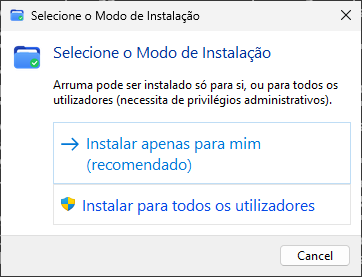

   A outra opção, «Instalar para todos os utilizadores», instala em `C:\Program Files\Arruma`, precisa de uma conta de administrador e faz aparecer o «Controlo de Conta de Utilizador» do Windows.

4. Se o Arruma já estiver instalado, aparece agora uma caixa sobre a versão (ver [Mensagens que podem aparecer](#mensagens-que-podem-aparecer)). Numa primeira instalação, passas logo ao passo seguinte.
5. Na página «Selecione a localização de destino», deixa a pasta que vem proposta e carrega em «Seguinte».

   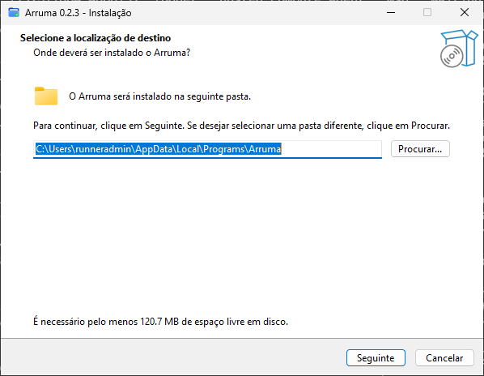

6. Na página «Selecione tarefas adicionais», escolhe se queres «Arrumar com o Arruma» no clique direito das pastas (vem marcado) e um atalho no Ambiente de Trabalho (vem desmarcado). Carrega em «Seguinte».

   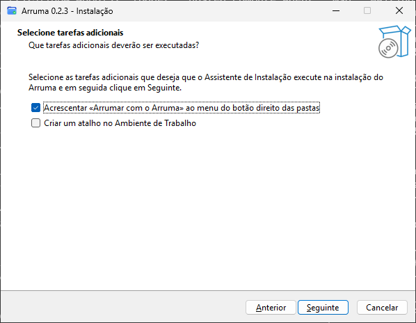

7. Em «Pronto para Instalar», confirma o resumo e carrega em «Instalar».

   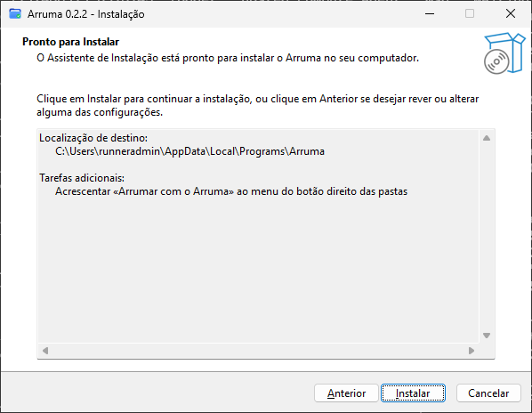

8. Em «Instalação do Arruma concluída», deixa marcado «Abrir o Arruma» e carrega em «Concluir».

   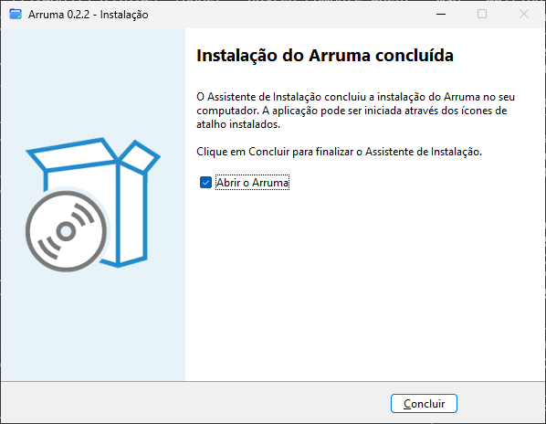

Daí em diante, abres o Arruma no menu Iniciar.

As imagens do instalador foram tiradas num Windows em inglês. Por isso, a caixa do modo de instalação mostra «Cancel» e as caixas sobre a versão (mais abaixo) mostram «Cancel», «Yes» e «No»; num Windows em português leem-se «Cancelar», «Sim» e «Não». A pasta de instalação mostra o utilizador da máquina onde as imagens foram tiradas («runneradmin»); no teu computador aparece o teu nome.

#### Controlo Inteligente de Aplicações (Windows 11)

Algumas instalações do Windows 11 têm ativo o Controlo Inteligente de Aplicações. Segundo a Microsoft, se uma aplicação não estiver assinada, esta proteção «irá considerá-la não fidedigna e bloqueá-la-á», e «Atualmente, não existe nenhuma forma de ignorar a proteção do Controlo Inteligente de Aplicações para aplicações individuais.» Como o Arruma não está assinado, é muito provável que, com esta proteção ativa, o instalador seja bloqueado sem opção para continuar (não foi possível experimentar num computador assim). O bloqueio vale também para o Arruma já instalado e para a versão portátil, por isso não chega desligá-la só para instalar.

A única saída é desativar o Controlo Inteligente de Aplicações, nas definições da aplicação Segurança do Windows. A decisão é tua: o computador fica com uma proteção a menos. A Microsoft diz que as atualizações recentes do Windows permitem voltar a ativá-lo mais tarde, mas, se o fizeres, o Arruma volta a ser bloqueado.

#### Versão portátil (sem instalar)

A versão portátil não cria entrada no menu Iniciar nem clique direito nas pastas, e não aparece na lista de aplicações instaladas.

1. Descarrega `Arruma-0.2.2-windows-portatil.zip`.
2. Extrai o ficheiro: clique direito em cima dele → «Extrair tudo…» (o nome pode variar ligeiramente). Não abras o Arruma de dentro do `.zip` sem extrair.
3. Abre a pasta `Arruma` que foi extraída e faz duplo clique em `Arruma.exe`. O aviso do SmartScreen (e, no Windows 11, o Controlo Inteligente de Aplicações) deve aparecer tal como para o instalador.

As definições e o histórico da versão portátil não ficam na pasta do Arruma, mas no mesmo sítio que os da versão instalada (ver [Onde ficam os teus dados](#onde-ficam-os-teus-dados)).

### macOS

1. Descarrega o instalador certo para o teu Mac (ver [Que Mac tenho?](#que-mac-tenho)): `Arruma-0.2.2-macos-apple-silicon.pkg` ou `Arruma-0.2.2-macos-intel.pkg`. Fica na pasta de descargas (`~/Downloads`).
2. Faz duplo clique no ficheiro. Na primeira vez, o macOS recusa abri-lo, porque o instalador não está assinado com um certificado de programador da Apple nem passou pela notarização da Apple. O aviso diz que a Apple não conseguiu verificar se o ficheiro está livre de software malicioso (a redação exata pode variar). Fecha-o com «Concluído» e não escolhas «Mover para o Lixo». Desde o macOS 15, o Control + clique já não serve para passar este aviso.
3. Abre o menu Apple → Definições do Sistema e, na barra lateral, carrega em «Privacidade e Segurança» (pode ser preciso deslocar a barra para baixo).
4. Desce até «Segurança». Ao lado da indicação de que o instalador do Arruma foi bloqueado, carrega em «Abrir» (o nome do botão pode variar ligeiramente, por exemplo «Abrir mesmo assim»). Este botão só fica disponível durante cerca de uma hora depois da tentativa do passo 2; se já lá não estiver, repete o passo 2.
5. O aviso volta a aparecer, agora com a opção de abrir. Carrega em «Abrir», escreve a palavra-passe com que entras no Mac e carrega em «OK». A partir daqui, o ficheiro abre com duplo clique.
6. Abre-se o instalador, «Instalar Arruma 0.2.2», na página «Introdução». Carrega em «Continuar».

   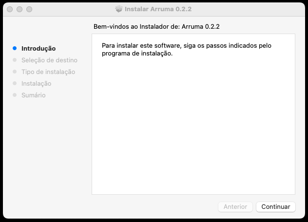

7. Segue com «Continuar» até à página «Tipo de instalação» e carrega em «Instalar» (daqui em diante, os nomes dos botões podem variar ligeiramente). A página «Seleção de destino» pode ser saltada, porque o Arruma só se instala no disco do sistema.
8. O macOS pede a palavra-passe de administrador (ou o Touch ID). Escreve-a e confirma; o botão deve chamar-se «Instalar software».
9. Na página «Sumário», carrega em «Fechar». O macOS pode perguntar se queres mover o instalador para o Lixo; podes fazê-lo, já não é preciso.
10. Abre o Arruma na pasta Aplicações ou no Launchpad.

Na primeira vez que o Arruma lê a Secretária, os Documentos, as Transferências, um disco externo ou uma pasta de rede, o macOS pergunta se o deixas aceder (por exemplo «“Arruma” gostaria de aceder a ficheiros na pasta Secretária.»; a redação pode variar ligeiramente). Por baixo da pergunta aparece a explicação do Arruma, como «O Arruma lê e arruma os ficheiros da Secretária apenas quando escolheres essa pasta.». Carrega em «Permitir»; sem isso, o Arruma não consegue ler essa pasta.

**Alternativa no Terminal.** Em vez dos passos 2 a 5, podes tirar ao ficheiro a marca de quarentena e depois abri-lo com duplo clique:

```bash
xattr -d com.apple.quarantine ~/Downloads/Arruma-*-macos-*.pkg
```

Se o ficheiro já não tiver essa marca, o comando responde com um erro do género `No such xattr: com.apple.quarantine`, que podes ignorar.

## Mensagens que podem aparecer

Estas tabelas juntam as mensagens que podes ver ao instalar, atualizar ou remover o Arruma, tanto as do sistema operativo como as dos instaladores. As do Arruma estão escritas exatamente como aparecem. As do sistema vêm das traduções oficiais sempre que foi possível confirmá-las; quando não foi, a tabela diz que a redação pode variar ligeiramente. Nos exemplos, «ana» é o nome de utilizador e 0.3.0 é uma versão mais recente imaginária.

### Linux

#### No Terminal

| Mensagem | Quando aparece | O que fazer |
|---|---|---|
| `[sudo] senha para ana:` | O `sudo` pede a palavra-passe de administrador. | Escreve a palavra-passe com que entras no computador e carrega em Enter. No Linux Mint aparece um asterisco por letra; noutros sistemas não aparece nada, mas o que escreves conta. |
| `Enganou-se, tente de novo.` | A palavra-passe estava errada. | Escreve-a outra vez, com atenção às maiúsculas. |
| `sudo: 3 tentativas incorrectas` | Erraste três vezes. | Repete o comando desde o início. |
| `ana não está no ficheiro sudoers.` | A tua conta não é de administrador. | Pede a quem administra o computador para instalar o pacote, ou usa o [`instalar.sh`](#só-para-ti-sem-palavra-passe-de-administrador), que não precisa de palavra-passe. |
| `A ler as listas de pacotes... Feito`, `A preparar para desempacotar ...`, `A descompactar arruma (0.2.2) ...`, `A instalar arruma (0.2.2) ...`, `A processar 'triggers' para ...` | Durante a instalação. | Nada; é o progresso normal. |
| `Note, a selecionar 'arruma' em vez de './arruma_0.2.2_all.deb'` | O apt reconheceu o ficheiro. | Nada. |
| `Os pacotes adicionais seguintes serão instalados:` (no Linux Mint 22: `Os seguintes pacotes adicionais vão ser instalados:`) | Faltam peças de que o Arruma precisa e o apt vai descarregá-las. | Responde à pergunta seguinte com Enter. É preciso internet. |
| `Pacotes recomendados:` | O sistema não vai instalar os extras recomendados. | Instala-os à parte ([comando](#com-o-terminal-recomendado)). |
| `Pacotes sugeridos:` | O apt lista idiomas extra para a leitura de digitalizações (espanhol, francês, alemão, italiano). | Nada, a não ser que queiras ler PDF digitalizados nesses idiomas. |
| `Deseja continuar? [S/n]` | Há outros pacotes a instalar (ou a remover). | Carrega em Enter. O «S» maiúsculo é a resposta que vale quando só carregas em Enter. |
| `N: Download is performed unsandboxed as root as file '/home/ana/Transferências/arruma_0.2.2_all.deb' couldn't be accessed by user '_apt'. - pkgAcquire::Run (13: Permissão recusada)` | O ficheiro está na tua pasta pessoal. | Nada; é só um aviso e a instalação continua. |
| `E: Ficheiro não suportado ./arruma_0.2.2_all.deb dado na linha de comandos` | O Terminal está noutra pasta e não encontra o ficheiro. | Escreve `cd ~/Transferências` (ou a pasta onde está o ficheiro) e repete. |
| `E: Não foi possível encontrar o pacote arruma_0.2.2_all.deb` (no Linux Mint 22: `E: Incapaz de localizar o pacote arruma_0.2.2_all.deb`) | Faltou o `./` antes do nome. | Repete com `./arruma_0.2.2_all.deb`. |
| `Os pacotes a seguir têm dependências não satisfeitas:` seguido de `arruma : Depende: python3 (>= 3.10)` (a redação pode variar ligeiramente) | O sistema é antigo demais (Linux Mint 20 ou anterior). | O Arruma precisa do Linux Mint 21 ou mais recente. |
| `arruma já é a versão mais recente (0.2.2).` (no Linux Mint 22: `arruma já está na versão mais recente (0.2.2).`) | Já tens esta versão. | Nada. Para reinstalar, ver [Atualizar, reinstalar e desinstalar](#atualizar-reinstalar-e-desinstalar). |
| `Será reposta uma versão ANTERIOR dos seguintes pacotes:` | Tens instalada uma versão mais recente do que a do ficheiro. | Para ficares com a mais recente, escreve `n` e carrega em Enter. Enter sozinho aceita descer de versão. |

#### No Instalador de Pacotes (duplo clique)

| Mensagem | Quando aparece | O que fazer |
|---|---|---|
| «Requer alterações em 3 outros pacotes» (no GDebi, «Requer a instalação de 3 pacotes»; o número varia) | Faltam peças de que o Arruma precisa. | Carrega em «Instalar pacote»; o instalador trata delas. |
| «Para instalar este pacote, é necessário autenticar-se.» (no GDebi, «Authentication is required to run GDebi») | Pedido da palavra-passe. | Escreve a tua palavra-passe. |
| «A instalação foi bem sucedida» e «arruma 0.2.2 está agora instalado.» (no GDebi, «Instalação completa» e «Pacote 'arruma_0.2.2_all.deb' foi instalado») | Fim da instalação. | Abre o Arruma no menu. |
| «A mesma versão já está instalada» | Já tens esta versão. | Nada. Se quiseres reinstalar, o botão passa a «Reinstalar pacote». |
| «Erro: Uma versão mais recente já se encontra instalada» | Tens uma versão mais recente. | O instalador não deixa descer de versão: ficas com a que tens. |
| «Falha ao instalar todas as dependências», seguido de «To fix this run 'sudo apt-get install -f' in a terminal window.» (esta segunda frase pode aparecer em inglês) | Faltou instalar alguma peça. | No Terminal, corre `sudo apt-get install -f`. |

#### Linhas «Arruma: …» durante a instalação do pacote

Só aparecem se houver uma cópia do `instalar.sh` na pasta pessoal de algum utilizador do computador. Nenhuma delas impede a instalação, e em nenhum caso o histórico e as definições são tocados.

| Mensagem | O que quer dizer | O que fazer |
|---|---|---|
| «Arruma: retirada a cópia antiga em /home/ana/.local (o histórico e as definições ficam).» | O pacote retirou a cópia do `instalar.sh`. | Nada. |
| «Arruma: a cópia em /home/ana/.local é a versão 0.3.0, mais recente do que este pacote (0.2.2).», seguida de «Fica onde está e continua a ter prioridade; para usar o pacote, retira-a com ./instalar.sh --remover (o histórico e as definições ficam).» | A cópia do `instalar.sh` é mais recente e continua a ser a que abre. | Se preferires o pacote, corre `./instalar.sh --remover` na pasta onde extraíste o código. |
| «Arruma: a cópia antiga em /home/ana/.local está numa pasta ligada a outro sítio e ficou onde está.», seguida de «Para usar o pacote, retira-a com ./instalar.sh --remover (o histórico e as definições ficam).» | Por segurança, o pacote não mexe em pastas que apontam para outro sítio. | Corre `./instalar.sh --remover`. |
| «Arruma: não foi possível retirar toda a cópia antiga em /home/ana/.local; retira-a com ./instalar.sh --remover.» | A remoção ficou a meio. | Corre `./instalar.sh --remover`. |
| «Arruma: não foi possível procurar uma cópia antiga em /home/ana/.local.» | O pacote não conseguiu ver essa pasta pessoal. | Se esse utilizador alguma vez usou o `instalar.sh`, corre lá `./instalar.sh --remover`. |

#### Com o instalar.sh

| Mensagem | Quando aparece | O que fazer |
|---|---|---|
| «✓ Arruma instalado com sucesso!», com a lista dos sítios onde o encontras | Fim da instalação ou da atualização. | Abre o Arruma no menu, em Acessórios. |
| «O Arruma 0.2.2 já está instalado. Não há nada a atualizar.» | Já tens esta versão. | Nada. |
| «A atualizar o Arruma de 0.2.1 para 0.2.2 (o histórico e as definições ficam).» | Tens uma versão mais antiga. | Nada; a atualização continua sozinha. |
| «Está instalado o Arruma 0.3.0, mais recente do que a versão desta cópia (0.2.2). Substituir? [s/N]» | Tens uma versão mais recente. | Enter (ou `n`) mantém a que tens e responde «Nada foi alterado.»; `s` substitui. |
| «Está instalado o Arruma de versão desconhecida, que não se consegue comparar com esta cópia (0.2.2). Substituir? [s/N]» | Não foi possível ler a versão instalada. | `s` substitui; Enter mantém. |
| «O pacote arruma 0.2.2 já está instalado no sistema.» | Tens o pacote `.deb` instalado. O `instalar.sh` recusa-se sempre. | Lê a linha seguinte; ver também [Problemas frequentes](#problemas-frequentes). |
| «Opção desconhecida: --remove. Usa ./instalar.sh para instalar ou atualizar, ou ./instalar.sh --remover» / «para retirar o Arruma da pasta pessoal.» (com a opção que escreveste) | Escreveste uma opção que não existe. | Usa `./instalar.sh` ou `./instalar.sh --remover`. |
| «✓ Arruma removido da pasta pessoal.» / «O histórico e as definições ficam em ~/.local/share/arruma e ~/.config/arruma.» | Depois de `./instalar.sh --remover`. | Nada. |

### Windows

#### Avisos do Windows

| Mensagem | Quando aparece | O que fazer |
|---|---|---|
| «O Windows protegeu o seu PC» (a redação pode variar ligeiramente) | Ao abrir o instalador ou o `Arruma.exe` da versão portátil, porque não estão assinados. | Carrega em «Mais informações» e depois em «Executar mesmo assim» (ou «Executar de qualquer forma»). |
| Aviso de bloqueio do Controlo Inteligente de Aplicações (só no Windows 11; texto não confirmado) | Quando essa proteção está ativa. | Ver [Controlo Inteligente de Aplicações](#controlo-inteligente-de-aplicações-windows-11). |
| «Controlo de Conta de Utilizador»: «Pretende permitir que esta aplicação de um editor desconhecido faça alterações ao seu dispositivo?» (a redação pode variar ligeiramente) | Só se escolheres «Instalar para todos os utilizadores», ou ao desinstalar uma instalação feita assim. | «Sim». Numa conta sem administrador, o Windows pede o nome e a palavra-passe de um administrador. |
| «Este programa só pode ser instalado em versões do Windows preparadas para as seguintes arquiteturas:» | Windows de 32 bits. | O Arruma precisa do Windows de 64 bits. |
| Aviso do navegador de que o ficheiro não costuma ser descarregado (texto não confirmado) | Ao descarregar. | Escolhe manter o ficheiro. |

#### Caixas do instalador do Arruma

Aparecem logo a seguir à escolha do modo de instalação, quando o Arruma já está instalado nesse modo. O título é sempre «Instalação».

| Mensagem | Quando aparece | O que fazer |
|---|---|---|
| «O Arruma 0.2.2 já está instalado. Não há nada a atualizar.» / «Para o reinstalar, desinstala-o primeiro.» | Já tens esta versão. | «OK» fecha o instalador sem mudar nada. Para reinstalar, desinstala primeiro. |
| «O Arruma vai ser atualizado da versão … para a 0.2.2.» / «O histórico e as definições ficam.» | Tens uma versão mais antiga. | «OK» continua com a atualização; «Cancelar» fecha sem mudar nada. |
| «Está instalado o Arruma …, mais recente do que a versão deste instalador (0.2.2).» / «Queres mesmo substituí-lo pela versão mais antiga?» | Tens uma versão mais recente. | «Não» fecha sem mudar nada, e é quase sempre o que convém. «Sim» substitui pela versão mais antiga. |

Nas imagens, as versões 0.1.0 e 9.9.9 são versões de teste usadas para provocar as caixas.

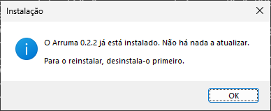

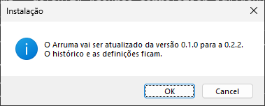

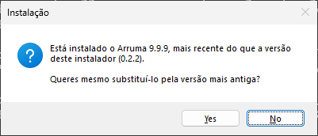

#### Outras caixas do assistente

| Mensagem | Quando aparece | O que fazer |
|---|---|---|
| «A pasta já existe» / «A pasta: … já existe. Pretende instalar nesta pasta?» | A pasta de instalação que escolheste já existe. | «Sim» se for a pasta do Arruma; senão, «Não» e escolhe outra. |
| «A preparar para instalar o Arruma no seu computador.», com «As seguintes aplicações estão a utilizar ficheiros que necessitam de ser atualizados pelo Assistente de Instalação. …» | O Arruma está aberto durante uma atualização. | Escolhe «Fechar as aplicações automaticamente» e continua. No fim, a caixa «Abrir o Arruma» volta a abri-lo. |
| «Terminar a instalação»: «A instalação não está completa. Se terminar agora, o programa não será instalado.» … «Deseja terminar a instalação?» | Carregaste em «Cancelar» a meio. | «Sim» desiste; «Não» continua. |
| «A instalação já está em execução.» | Abriste o instalador duas vezes. | Usa a janela que já está aberta. |

### macOS

#### Avisos do macOS

| Mensagem | Quando aparece | O que fazer |
|---|---|---|
| Aviso de que a Apple não conseguiu verificar se o instalador está livre de software malicioso, com os botões «Concluído» e «Mover para o Lixo» (a redação pode variar ligeiramente) | Na primeira vez que abres o `.pkg` descarregado. | «Concluído», e depois autoriza em Privacidade e Segurança (ver [Instalar no macOS](#macos)). |
| Indicação de que o instalador foi bloqueado, com o botão «Abrir», em Definições do Sistema → Privacidade e Segurança → Segurança (o nome do botão pode variar ligeiramente) | Até cerca de uma hora depois da tentativa de abrir. | «Abrir», e depois a tua palavra-passe. |
| Pedido da palavra-passe do Instalador, por exemplo «O Instalador está a tentar instalar novo software.» (a redação pode variar ligeiramente) | Na página «Tipo de instalação», depois de «Instalar». | Escreve a palavra-passe de administrador (ou usa o Touch ID). |
| Pedido para fechar o Arruma (texto não confirmado) | O Arruma está aberto durante uma atualização. | Fecha o Arruma e continua. |
| «“Arruma” gostaria de aceder a ficheiros na pasta Secretária.» (ou Documentos, Transferências, discos externos, pastas de rede; a redação pode variar ligeiramente), com a explicação do Arruma por baixo | Na primeira vez que o Arruma lê uma dessas pastas. | «Permitir». |
| Recusa do instalador `apple-silicon` num Mac Intel (texto não confirmado) | Descarregaste o instalador errado. | Descarrega o `intel`. |
| «A instalação falhou» (a redação pode variar ligeiramente) | Raro. Acontece, por exemplo, quando o Arruma está aberto noutra conta do Mac. | Fecha o Arruma nessa conta (ou termina a sessão dela) e volta a abrir o instalador. O motivo fica registado; para o ver, corre no Terminal `grep Arruma /var/log/install.log`. |

As explicações que o Arruma põe por baixo dos pedidos de acesso são estas:

| Pasta | Explicação |
|---|---|
| Secretária | «O Arruma lê e arruma os ficheiros da Secretária apenas quando escolheres essa pasta.» |
| Documentos | «O Arruma lê e arruma os teus documentos apenas quando escolheres essa pasta.» |
| Transferências | «O Arruma lê e arruma as Transferências apenas quando escolheres essa pasta.» |
| Discos externos | «O Arruma lê e arruma os discos externos que escolheres.» |
| Pastas de rede | «O Arruma lê e arruma as pastas de rede que escolheres.» |

#### Caixas do instalador do Arruma

Aparecem por cima da página «Introdução», logo que o instalador abre.

| Mensagem | Quando aparece | O que fazer |
|---|---|---|
| «Este instalador é para Macs com processador Intel» / «Este Mac tem um processador Apple (M1, M2, M3…). Descarrega o instalador «apple-silicon».» | Abriste o instalador Intel num Mac com processador Apple. | Não é possível continuar. Descarrega o `apple-silicon`. |
| «O Arruma 0.2.2 já está instalado» / «Não há nada a atualizar. Para o reinstalar, põe primeiro o Arruma no Lixo.» | Já tens esta versão. | «Fechar». Para reinstalar, põe primeiro o Arruma no Lixo. |
| «Está instalada uma versão mais recente» / «Está instalado o Arruma …, mais recente do que a versão deste instalador (0.2.2). Se continuares nesta janela, será substituído pela versão mais antiga. Pela linha de comandos fica como está; para o substituir, põe primeiro o Arruma no Lixo.» | Tens uma versão mais recente. | «OK». Para manter a mais recente, fecha o instalador sem continuar; se continuares, fica instalada a mais antiga. |

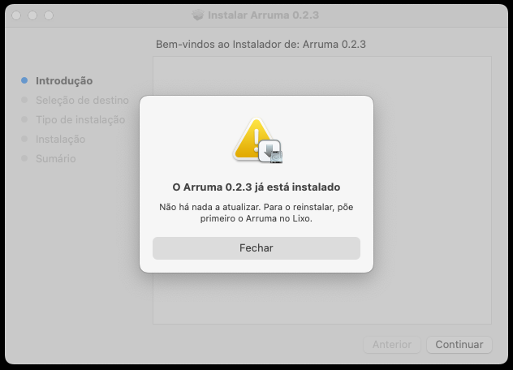

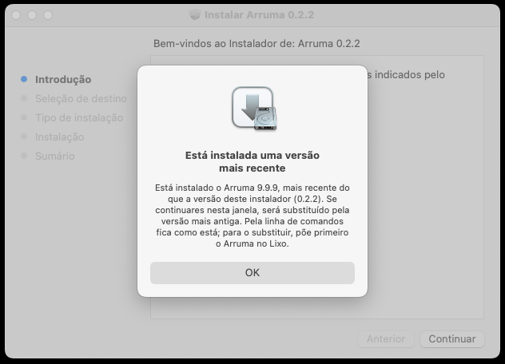

## Atualizar, reinstalar e desinstalar

Em qualquer sistema, atualizar é instalar a versão nova da mesma maneira. O instalador vê que versão tens: se for mais antiga, atualiza; se for a mesma, avisa que não há nada a atualizar; se for mais recente, pergunta antes de descer de versão. O histórico e as definições ficam sempre, também quando desinstalas.

### Linux

**Atualizar.** Descarrega o pacote novo e corre o mesmo comando da instalação, com o nome do ficheiro novo:

```bash
cd ~/Transferências
sudo apt install ./arruma_0.2.2_all.deb
```

Se a versão instalada for mais antiga, o apt atualiza sem perguntar e mostra `Serão atualizados os seguintes pacotes:` e `A descompactar arruma (0.2.2) sobre (0.2.1) ...`. Se for a mesma, responde `arruma já é a versão mais recente (0.2.2).` (no Linux Mint 22, `arruma já está na versão mais recente (0.2.2).`) e não muda nada. Se for mais recente, mostra `Será reposta uma versão ANTERIOR dos seguintes pacotes:` e pergunta `Deseja continuar? [S/n]`. Aqui, cuidado: Enter sozinho aceita descer de versão. Para manteres a mais recente, escreve `n` e carrega em Enter.

Com duplo clique no ficheiro, o Instalador de Pacotes recusa descer de versão e, para a mesma versão, oferece «Reinstalar pacote».

Cada vez que o pacote é instalado ou atualizado, retira também as cópias antigas do `instalar.sh` que encontrar nas pastas pessoais (ver as [linhas «Arruma: …»](#linhas-arruma--durante-a-instalação-do-pacote)).

Com o `instalar.sh`, atualizar é descarregar o código novo, extraí-lo e correr outra vez `./instalar.sh` nessa pasta. Se a versão instalada for mais recente, ele pergunta antes de a substituir.

**Reinstalar a mesma versão** (por exemplo, para reparar a instalação):

```bash
sudo apt install --reinstall ./arruma_0.2.2_all.deb
```

**Desinstalar:**

```bash
sudo apt remove arruma
```

O apt mostra `Serão REMOVIDOS os seguintes pacotes:` e pergunta `Deseja continuar? [S/n]`; carrega em Enter. No fim pode aparecer `Os seguintes pacotes foram instalados automaticamente e já não são necessários:` com a sugestão `Utilize 'sudo apt autoremove' para os remover.`: são peças que só o Arruma usava, e podes retirá-las com esse comando se quiseres. O `apt purge` faz o mesmo que o `apt remove`, porque o Arruma não guarda definições nas pastas do sistema.

Para retirar a cópia do `instalar.sh`, corre `./instalar.sh --remover` na pasta onde extraíste o código.

Em qualquer dos casos ficam `~/.config/arruma` (definições) e `~/.local/share/arruma` (histórico). Ver [Onde ficam os teus dados](#onde-ficam-os-teus-dados).

### Windows

**Atualizar.** Descarrega o instalador novo e abre-o (o aviso do SmartScreen pode voltar a aparecer). Desta vez não há pergunta sobre o modo de instalação nem página da pasta, e as tarefas adicionais vêm como as escolheste da última vez. Aparece a caixa «O Arruma vai ser atualizado da versão … para a 0.2.2.»; carrega em «OK» e segue o assistente. Se o Arruma estiver aberto, o assistente mostra a página «A preparar para instalar» (ver [Outras caixas do assistente](#outras-caixas-do-assistente)).

**Reinstalar a mesma versão.** O instalador recusa («Para o reinstalar, desinstala-o primeiro.»). Desinstala o Arruma e volta a instalá-lo. É também assim que mudas as tarefas adicionais, por exemplo para acrescentar ou tirar o «Arrumar com o Arruma» do clique direito.

**Desinstalar.** O Arruma não tem atalho próprio para desinstalar; usa o caminho do Windows:

1. No Windows 11: Iniciar → Definições → Aplicações → «Aplicações instaladas». Procura «Arruma», carrega no botão «…» (Mais) e escolhe «Desinstalar». No Windows 10, a página chama-se «Aplicações e funcionalidades» (o nome pode variar ligeiramente).
2. Em alternativa: Iniciar → «Todas as aplicações», clique direito em «Arruma» → «Desinstalar»; ou Painel de Controlo → Programas → «Programas e Funcionalidades».
3. O Windows pode mostrar primeiro uma confirmação. Depois, o desinstalador do Arruma (janela «Arruma - Desinstalação») pergunta «Tem a certeza que deseja remover completamente o Arruma e todos os seus componentes?»; carrega em «Sim».
4. No fim aparece «O Arruma foi removido do seu computador com sucesso.». Se aparecer «Alguns elementos não puderam ser removidos. Estes elementos podem ser removidos manualmente.», podes apagar à mão a pasta onde o Arruma estava instalado.

A desinstalação retira o programa, os atalhos e as entradas do clique direito. Se instalaste para todos os utilizadores, o Windows pede autorização de administrador.

A versão portátil remove-se apagando a pasta `Arruma`.

Em qualquer dos casos fica a pasta `%APPDATA%\Arruma`, com as definições e o histórico.

### macOS

**Atualizar.** Descarrega o `.pkg` novo e repete a [instalação](#macos), incluindo a autorização em Privacidade e Segurança, porque o ficheiro novo também é bloqueado da primeira vez. Se o Arruma estiver aberto, o instalador pede para o fechar. Quem tinha a versão 0.2.0 (que vinha num `.dmg` e se arrastava para Aplicações) pode instalar o `.pkg` por cima: ele substitui essa cópia.

**Descer de versão.** Com uma versão mais recente instalada, o instalador mostra «Está instalada uma versão mais recente». Se continuares, fica a versão mais antiga.

**Reinstalar a mesma versão.** O instalador recusa («Para o reinstalar, põe primeiro o Arruma no Lixo.»). Põe o Arruma no Lixo e volta a instalá-lo.

**Desinstalar.**

1. Fecha o Arruma.
2. Abre o Finder e, na barra lateral, carrega em «Aplicações».
3. Arrasta o Arruma para o Lixo, na ponta da Dock. Como foi o Instalador que o pôs lá, o Finder deve pedir a palavra-passe de administrador.
4. O Arruma desaparece de vez quando esvaziares o Lixo.

Fica a pasta `~/Library/Application Support/Arruma`, com as definições e o histórico. Fica também um recibo do Instalador, que não atrapalha uma instalação futura; quem quiser pode apagá-lo no Terminal com `sudo pkgutil --forget pt.arruma.Arruma`.

## Usar o Arruma

As imagens desta parte foram tiradas no Linux Mint, com pastas de exemplo. No Windows e no macOS o Arruma é igual, com o aspeto Adwaita em vez do do Linux Mint e com os nomes que o sistema dá às pastas: no Windows vês «Ambiente de Trabalho» e «Reciclagem», no macOS «Secretária», «Filmes» e «Lixo». No macOS, os atalhos de teclado usam Cmd em vez de Ctrl; no Windows, os caminhos aparecem completos (`C:\Users\…`) em vez de começarem por `~`.

### A janela

Na barra de cima, à esquerda, está o botão «Escolher pastas…» (atalho Ctrl+O). Ao centro, o nome do Arruma e, por baixo, o que estás a analisar. À direita, um indicador colorido com o estado da IA local («Modo regras» quando não há IA, «IA local: qwen2.5:3b» quando está pronta, «IA desligada» quando a desligaste) e o botão com um «i», «Acerca do Arruma».

A barra lateral tem as seis vistas: «Início», «Análise», «Plano», «Duplicados», «Histórico» e «Definições». Os números pequenos ao lado dizem quantos ficheiros tem a última análise, quantas alterações propõe o plano e quantos grupos de cópias foram encontrados. Podes mudar de vista quando quiseres.

Atalhos de teclado: Ctrl+O escolhe pastas e começa a análise, Ctrl+Q fecha o Arruma e F2 muda um nome na vista Plano.

### A primeira arrumação

Para ganhares confiança, começa por uma pasta só, por exemplo Transferências.

1. No [Início](#início), clica no cartão «Transferências» e depois no botão verde «Analisar «Transferências»». O Arruma só lê; não muda nada.
2. Na [Análise](#análise), vê o que ele encontrou. Desce até «Pronto para arrumar?», deixa escolhido «Nas pastas pessoais (Documentos, Imagens, Vídeos, Música…)» e carrega em «Criar plano de organização».
3. No [Plano](#plano), percorre a lista. Desmarca o que não queres mudar e corrige um destino ou um nome se for preciso. Ainda nada mudou no disco.
4. Carrega em «Aplicar alterações» e confirma com «Aplicar». Espera até aparecer «Está arrumado!».
5. Abre as pastas e vê o resultado. Se não gostares, carrega em «Anular»: no ecrã «Está arrumado!», na notificação que aparece em baixo ou, mais tarde, no [Histórico](#histórico). Tudo volta ao sítio onde estava.

### Início

É aqui que escolhes o que arrumar. Cada cartão é uma pasta: Transferências, Secretária, Documentos, Imagens, Vídeos e Música (com os nomes do teu sistema, e só as que existem), a «Pasta pessoal», «Todo o computador» e «Outras pastas…». Por baixo do nome vês quantos itens tem lá dentro, sem contar os ocultos.

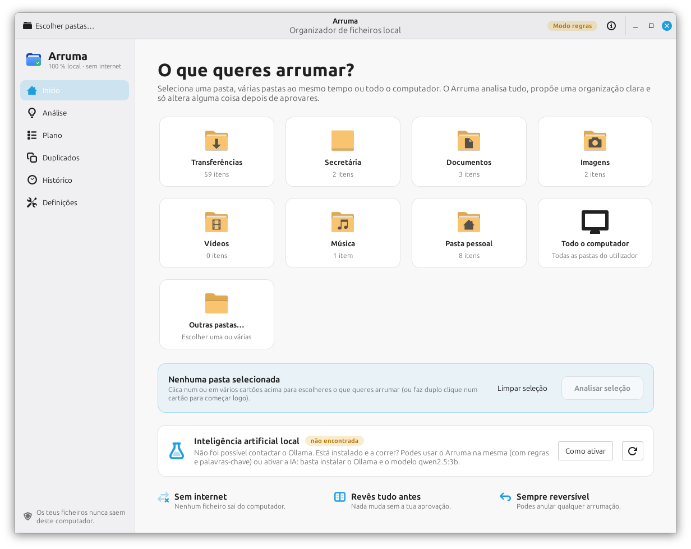

Um clique num cartão seleciona-o (aparece um visto no canto) e outro clique tira a seleção. Podes juntar várias pastas. A barra por baixo dos cartões diz o que está selecionado, e o botão verde à direita começa a análise: «Analisar «Transferências»» para uma pasta, «Analisar 3 pastas» para três. «Limpar seleção» tira tudo. Se fizeres duplo clique num cartão, a análise começa logo, só com essa pasta.

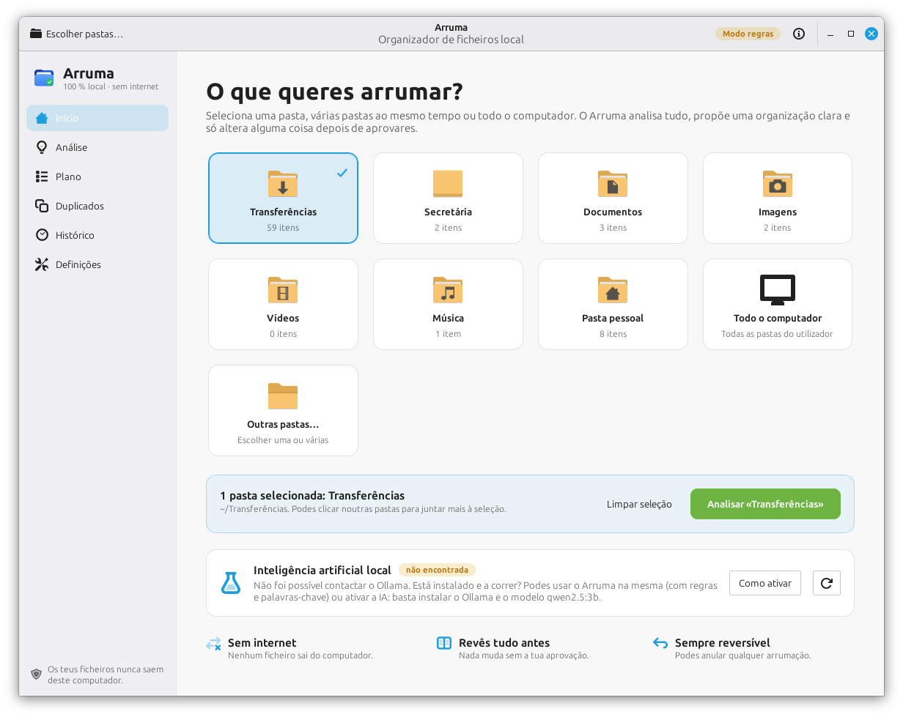

«Todo o computador» não se junta às outras: selecioná-lo tira a seleção das restantes, e selecionar outra pasta tira a dele. Inclui sempre a tua pasta pessoal e, conforme o computador, outros discos e pastas onde podes escrever. No Linux entram os discos montados em `/media`, `/run/media` e `/mnt` e as outras pastas de `/home` a que tens acesso; no macOS, os discos em `/Volumes`, exceto o do sistema. A lista exata aparece na barra, depois de «Inclui:». As pastas internas do sistema operativo ficam sempre de fora.

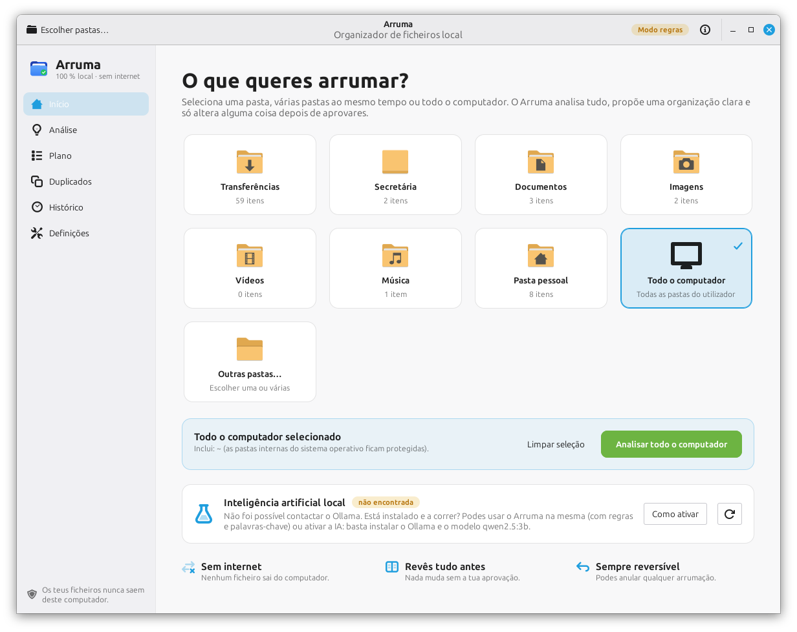

Para outras pastas há dois caminhos, que não fazem o mesmo. O cartão «Outras pastas…» abre o seletor «Escolhe uma ou mais pastas a arrumar»; as pastas que escolheres ganham um cartão e ficam selecionadas, mas a análise só começa quando carregares no botão verde. O botão «Escolher pastas…», na barra de cima, abre o mesmo seletor e começa a análise logo a seguir. No seletor, mantém a tecla Ctrl carregada (Cmd no macOS) para escolher várias pastas, e carrega em «Escolher». Os cartões criados por «Outras pastas…» desaparecem quando fechas o Arruma.

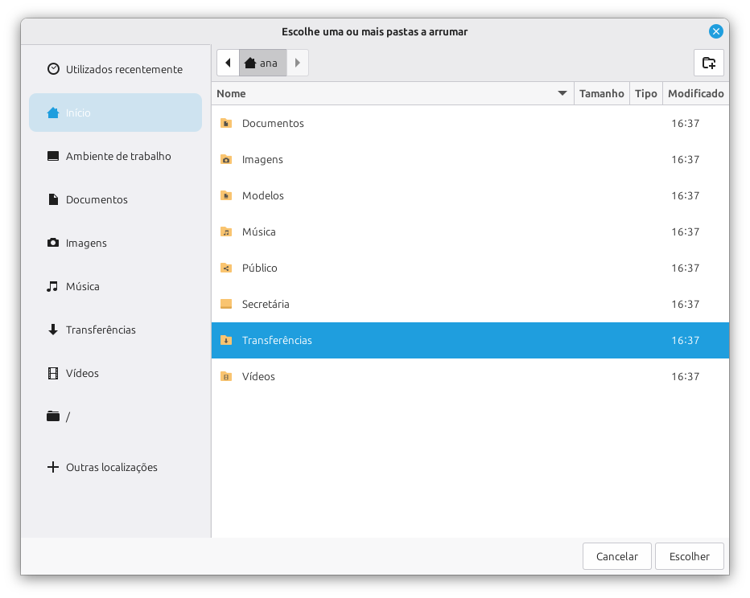

Algumas pastas não se podem escolher. Se tentares, aparece «Não é possível escolher esta pasta», com o motivo: «Esta é uma pasta do sistema. Por segurança, o Arruma não lhe toca.», «Esta pasta contém configurações de programas e não deve ser reorganizada.», «A pasta não existe.» ou «Não tens permissão para alterar esta pasta.». Se escolheste várias e uma delas falhar, nenhuma é analisada; tira essa e tenta de novo. A raiz do disco (`/` no Linux e no macOS, `C:\` no Windows) não dá erro: conta como «Todo o computador».

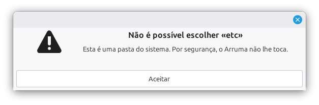

Mais abaixo está o cartão «Inteligência artificial local», que diz se a IA está pronta («ativa»), por encontrar («não encontrada»), desligada («desligada») ou a ser verificada («a verificar…»). O botão «Como ativar» mostra os passos para a instalar, e o botão da seta redonda («Verificar novamente») volta a procurá-la. Sem IA, o Arruma funciona na mesma; ver [IA local](#ia-local).

### Análise

A vista Análise abre sozinha quando começas uma análise. Enquanto lê, mostra «A analisar «Transferências»», a pasta em curso e quantos ficheiros já encontrou, com a nota «Só leitura: nenhum ficheiro é alterado nesta fase.». «Cancelar» para a análise e volta ao Início. Se ainda não analisaste nada, a vista diz «Ainda não analisaste nenhuma pasta» e tem o botão «Ir para o Início».

No fim aparece o resultado.

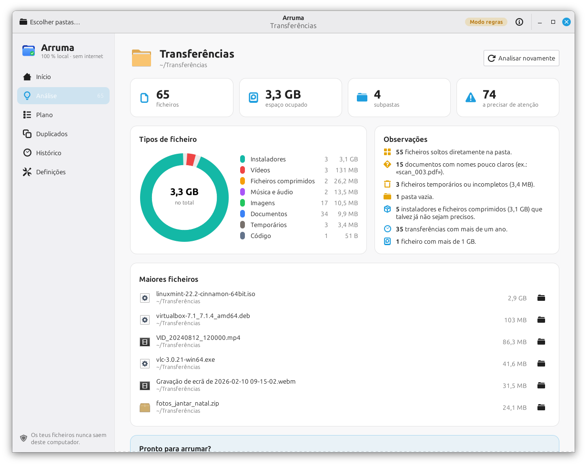

Em cima, quatro números: «ficheiros», «espaço ocupado», «subpastas» e «a precisar de atenção». Este último soma as observações de aviso (ficheiros soltos, nomes pouco claros, temporários e pastas vazias), por isso o mesmo ficheiro pode contar duas vezes.

O cartão «Tipos de ficheiro» mostra quanto espaço ocupa cada tipo: documentos, imagens, vídeos, música e áudio, instaladores, ficheiros comprimidos, código, temporários e outros.

O cartão «Observações» resume o que merece atenção, com o número a negrito. Podes ver, por exemplo, «55 ficheiros soltos diretamente na pasta.» (aparece com mais de 15), «15 documentos com nomes pouco claros (ex.: «scan_003.pdf»).», ficheiros temporários ou incompletos, pastas vazias, instaladores e ficheiros comprimidos «que talvez já não sejam precisos» (não são apagados: no plano vão para pastas próprias), transferências com mais de um ano, ficheiros com mais de 1 GB, pastas protegidas que não vão ser alteradas, itens ocultos ignorados e itens que não puderam ser lidos por falta de permissão. Se estiver tudo bem, lê-se «Tudo parece em ordem. 👍».

«Maiores ficheiros» lista os seis maiores. O botão da pasta, à direita de cada um, mostra-o no gestor de ficheiros (no Windows, no Explorador de Ficheiros; no macOS, no Finder).

No fundo da página está o cartão «Pronto para arrumar?».

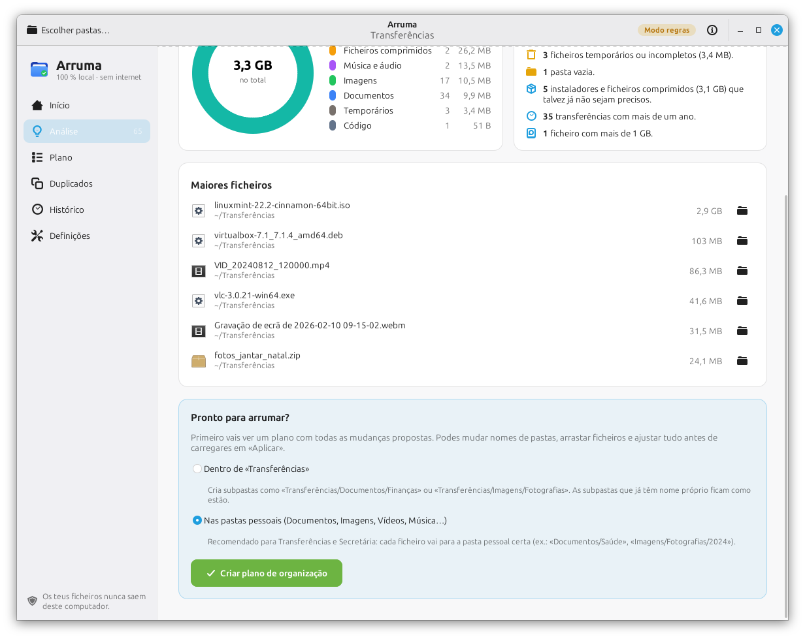

Aqui escolhes uma de duas maneiras de arrumar:

- **«Dentro de «X»»** cria subpastas dentro da própria pasta, como «X/Documentos/Finanças» ou «X/Imagens/Fotografias». As subpastas que já têm nome próprio ficam como estão. Vem escolhida para as pastas que não são Transferências, Secretária nem a pasta pessoal.
- **«Nas pastas pessoais (Documentos, Imagens, Vídeos, Música…)»** manda cada ficheiro para a pasta pessoal certa, como «Documentos/Saúde» ou «Imagens/Fotografias/2024». É a recomendada para Transferências e Secretária, e vem escolhida para essas e para a pasta pessoal.

Com várias pastas, a primeira opção passa a «Dentro de cada uma das N pastas escolhidas» e a segunda junta os ficheiros de todas nas pastas pessoais. Se a pasta pessoal fizer parte da seleção, só a segunda está disponível. Com «Todo o computador», a segunda opção arruma a pasta pessoal nas pastas pessoais e cada disco externo dentro de si próprio; a primeira, «Dentro de cada pasta ou disco analisado», aparece sempre desativada nesta versão. Se escolheres uma pasta e outra que está dentro dela, conta só a de cima.

Carrega em «Criar plano de organização» para ver o plano. Nada é alterado ainda.

O botão «Analisar novamente», no canto de cima, repete a análise das mesmas pastas. Usa-o sempre que mexeres nos ficheiros por fora do Arruma e depois de aplicares um plano: a análise não se atualiza sozinha, e um plano feito a partir de uma análise antiga dá erros «O ficheiro já não existe no local original.». Uma análise nova (também a de «Analisar novamente») apaga o plano que tinhas, com as mudanças que lhe fizeste à mão, sem perguntar.

Se algo correr mal durante a análise, aparece «Erro ao analisar a pasta» com a explicação técnica, e voltas ao Início.

### Plano

O plano é a proposta do Arruma: o que vai para onde, o que muda de nome e o que vai para o Lixo. Enquanto não carregares em «Aplicar alterações», é só uma proposta e podes mudá-la à vontade. Se ainda não há plano, a vista diz «Ainda não há plano».

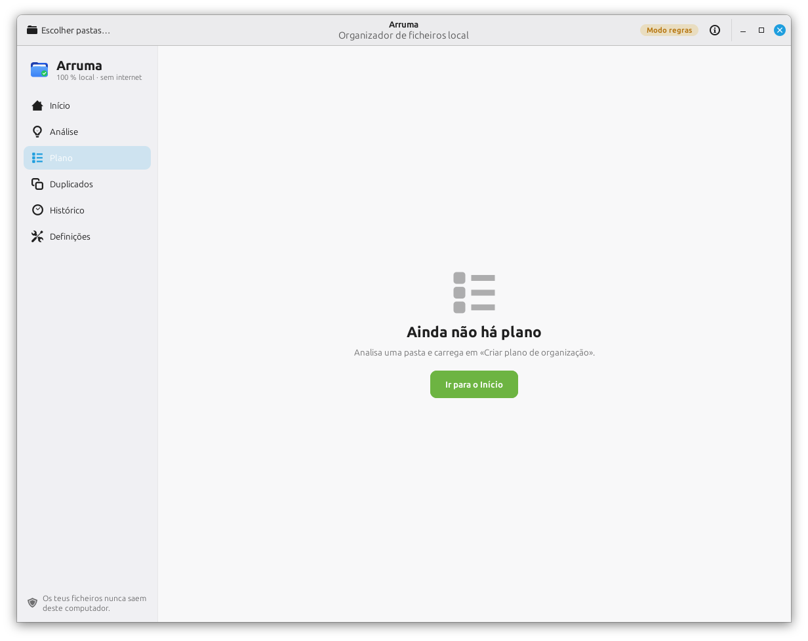

#### Enquanto o plano é preparado

Aparece «A preparar o plano», com a nota «Ainda nada é alterado: isto é só a proposta.». O título vai mudando com a fase («A classificar os ficheiros», «A ler o conteúdo dos documentos» e, com IA, «A IA local está a ler os documentos»), com o ficheiro em curso e um contador. Na fase da IA, o contador mostra também o tempo que falta e aparece a nota «A IA corre no teu processador, por isso pode demorar. Os resultados ficam guardados: da próxima vez é muito mais rápido.». Se não quiseres esperar, «Continuar sem IA» classifica os documentos que faltam por palavras-chave. «Cancelar» desiste do plano e volta à Análise.

Se não houver nada a mudar, aparece «Já está tudo arrumado!» e «Não há nada a mudar nesta seleção. 🎉», com o botão «Escolher outra pasta».

#### O que vês no plano

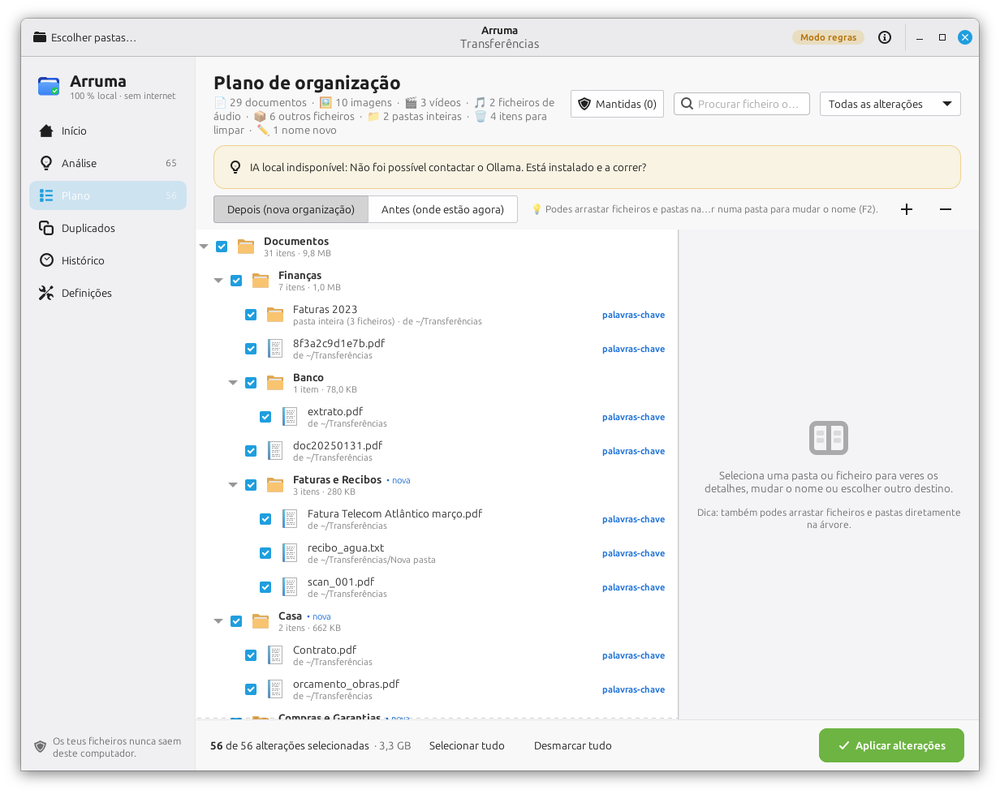

No topo, «Plano de organização» e um resumo do que vai acontecer: quantos documentos, imagens, vídeos, ficheiros de áudio e outros ficheiros vão mudar, quantas «pastas inteiras», quantos «itens para limpar» e quantos «nomes novos». Se a IA esteve a trabalhar, uma segunda linha diz quantos documentos ela leu.

Ao lado tens o botão «Mantidas», que abre a lista «Pastas que ficam como estão»: pastas com nome próprio, projetos e pastas de outros programas que o plano deixa intactas, cada uma com o motivo. A caixa «Procurar ficheiro ou pasta…» filtra pelo nome ou pelo caminho, de origem ou de destino. A lista à direita filtra por tipo de alteração: «Todas as alterações», «Documentos», «Imagens», «Vídeos», «Música e áudio», «Outros tipos», «Pastas inteiras», «Limpeza», «Com nome novo», «Classificados pela IA» e «A rever (pouca certeza)». Começa por este último: mostra os ficheiros em que o Arruma tem menos de 55 % de certeza.

Às vezes aparece uma nota amarela por cima da lista. «IA local indisponível: …» quer dizer que a IA está ligada nas Definições mas não respondeu, e o plano foi feito sem ela (é o caso das imagens deste manual). Se não queres usar a IA, desliga-a nas [Definições](#definições) e a nota deixa de aparecer. Outras notas avisam que a IA foi interrompida ou deixou de responder a meio, e que o resto foi classificado por palavras-chave.

A lista pode ser vista de duas maneiras, com os botões «Depois (nova organização)» e «Antes (onde estão agora)». Os botões «+» e «−» abrem e fecham todas as pastas.

Na árvore **«Depois»** vês as pastas de destino. Cada pasta mostra o nome a negrito, quantos itens vai ter e o tamanho; «• nova» quer dizer que ainda não existe e vai ser criada. Cada ficheiro mostra por baixo de onde vem («de ~/Transferências»); se mudar de nome, aparece «✏️ nome novo» e «era «nome antigo» em ~/pasta». Uma subpasta movida com tudo o que tem aparece como «pasta inteira (N ficheiros)». No topo podem aparecer dois grupos especiais: «Para o Lixo» (no Windows, «Para a Reciclagem») e «Pastas vazias a remover».

No Windows e no macOS, a árvore mostra os nomes que as pastas pessoais têm no disco (`Documents`, `Pictures`, `Downloads`…), enquanto os cartões e os textos usam os nomes em português. As subpastas que o Arruma cria têm sempre nomes portugueses («Finanças», «Fotografias»…).

Na árvore **«Antes»** vês os ficheiros agrupados pelas pastas onde estão agora, e por baixo de cada um para onde vai: «→ ~/Documentos/Casa/Contrato.pdf», «→ Lixo (recuperável)» ou «→ remover (está vazia)».

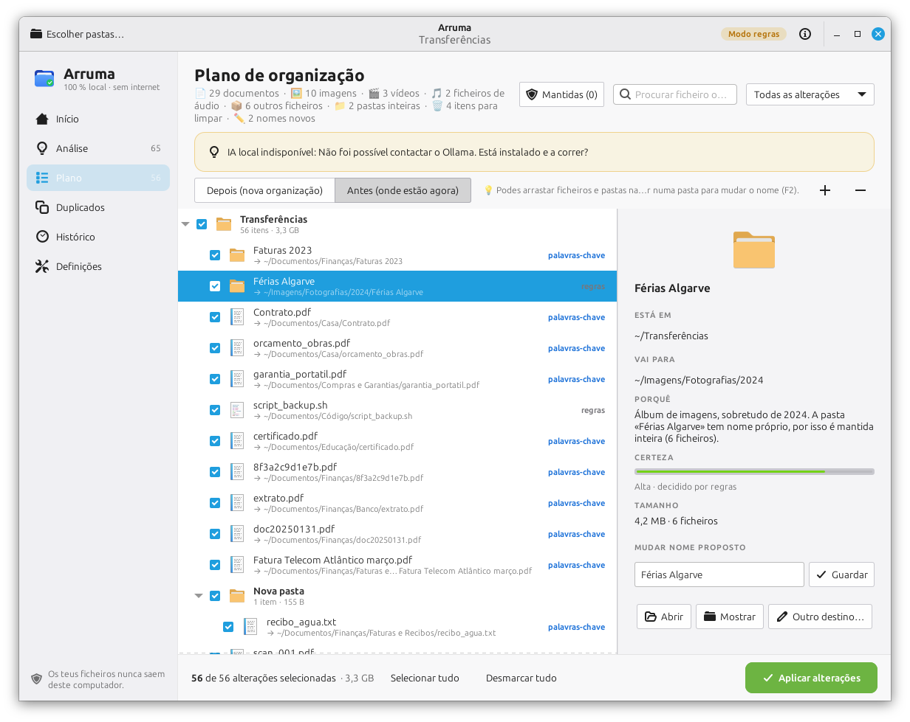

À direita de cada linha, uma etiqueta colorida diz quem decidiu: «IA», «palavras-chave», «metadados» (datas das fotografias, etiquetas da música), «regras» ou «escolha tua». Um «⚠️» marca as decisões com pouca certeza.

Cada linha tem uma caixa. Uma caixa marcada quer dizer que essa alteração vai ser feita. Desmarcar um ficheiro tira-o do plano: fica onde está. Desmarcar uma pasta desmarca tudo o que está dentro. As caixas são as mesmas nas duas árvores. Na barra de baixo vês «56 de 56 alterações selecionadas» e o tamanho; «Selecionar tudo» e «Desmarcar tudo» só atuam sobre o que está visível com o filtro e a pesquisa atuais, o que dá jeito para, por exemplo, desmarcar toda a «Limpeza» de uma vez.

Ao clicares num ficheiro, o painel da direita mostra os detalhes:

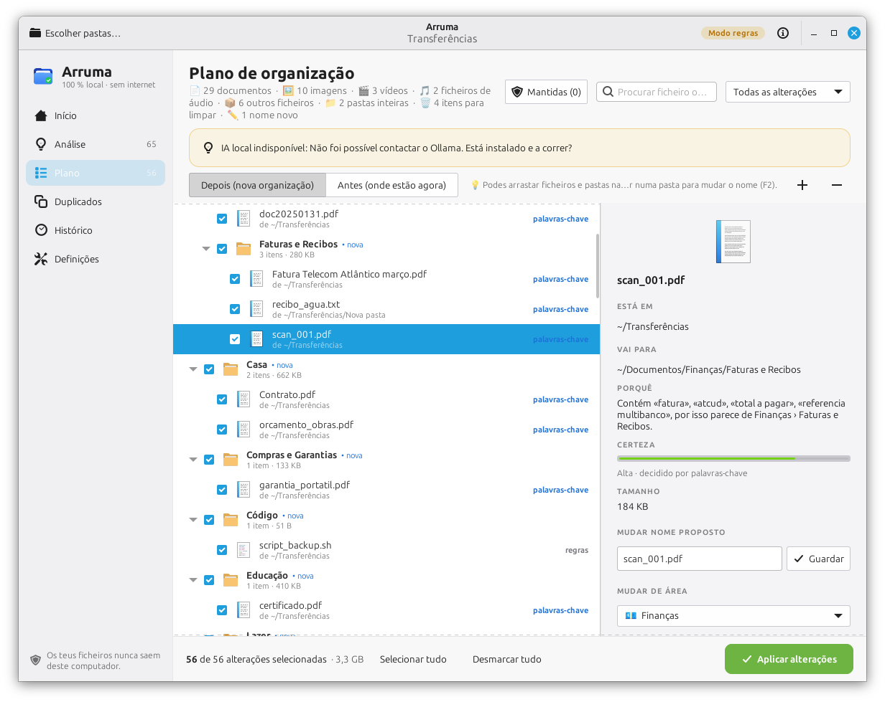

- «NOME ATUAL», se o nome muda; «ESTÁ EM», a pasta atual; «VAI PARA», a pasta de destino.
- «PORQUÊ», o motivo da decisão, por exemplo «Contém «fatura», «atcud», «total a pagar», «referencia multibanco», por isso parece de Finanças › Faturas e Recibos.».
- «CERTEZA», com uma barra e «Alta», «Média» ou «Baixa: confirma», e quem decidiu.
- «TAMANHO».
- «MUDAR NOME PROPOSTO», para escolheres outro nome, e «MUDAR DE ÁREA», só para documentos.
- Os botões «Abrir» (abre o ficheiro com o programa habitual), «Mostrar» (mostra-o no gestor de ficheiros) e «Outro destino…».

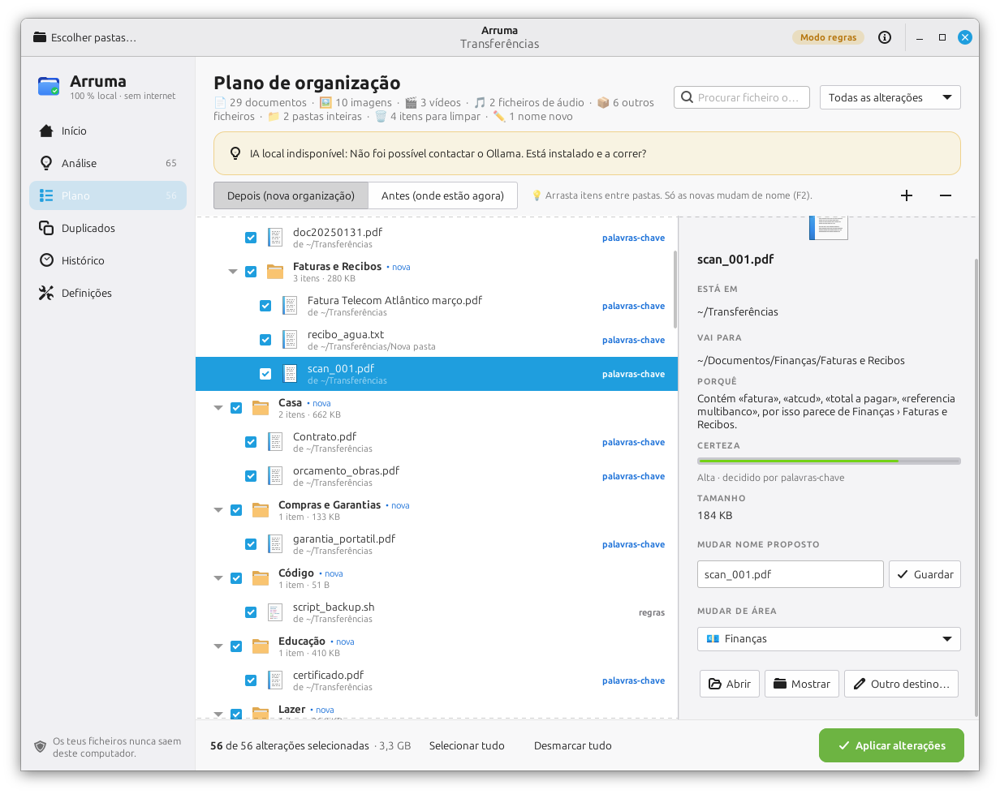

Ao clicares numa pasta da árvore «Depois», o painel mostra «LOCAL», «CONTEÚDO» e, se for nova, «Esta pasta ainda não existe e será criada.», além de «MUDAR NOME DA PASTA» e do botão «Mover pasta para outro local…».

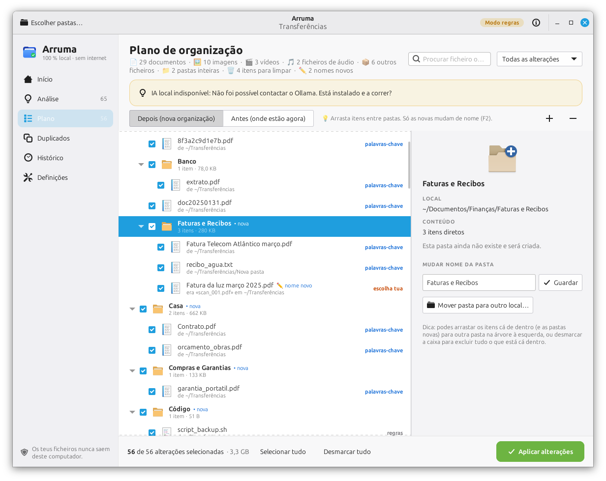

#### Para onde vai cada coisa

Conhecer as regras ajuda a confiar no plano e a corrigi-lo depressa.

**As duas maneiras de arrumar.** «Nas pastas pessoais» manda cada ficheiro solto para a pasta pessoal do seu tipo. As subpastas com nome próprio das pastas escolhidas (e de Transferências e da Secretária) são movidas inteiras, com tudo o que têm, para o sítio do tipo que predomina nelas: um álbum de fotografias como «Férias Algarve» vai para `Imagens/Fotografias/2024/Férias Algarve`, uma pasta de documentos para `Documentos/<área>/<pasta>`. Quando arrumas a pasta pessoal, são arrumados os ficheiros soltos nela e diretamente em Documentos, Imagens e nas outras pastas pessoais; as subpastas com nome próprio ficam, e Transferências e a Secretária são esvaziadas como acima. Se juntares várias pastas, os ficheiros vão todos para as mesmas pastas pessoais.

«Dentro de…» cria, dentro da pasta escolhida, só as pastas que forem precisas: «Documentos», «Imagens», «Vídeos», «Música», «Ficheiros comprimidos», «Instaladores», «Código» e «Outros ficheiros». Se arrumares por dentro a tua própria pasta Documentos (ou Imagens, Vídeos, Música), o Arruma não cria `Documentos/Documentos`: as áreas ficam logo em `Documentos`. E se uma pasta tiver pelo menos 5 ficheiros e 90 % ou mais forem do mesmo tipo (uma pasta só de fotografias, por exemplo), esse tipo fica diretamente nela.

Nas duas maneiras, a pasta que escolheste nunca é apagada, mesmo que fique vazia.

**Os destinos.** Com «Nas pastas pessoais», cada tipo vai para aqui. Com «Dentro de…», a arrumação é parecida mas fica dentro da pasta escolhida, e os ficheiros comprimidos, os instaladores, o código e os outros ficheiros vão para as pastas «Ficheiros comprimidos», «Instaladores», «Código» e «Outros ficheiros» dessa pasta.

| Ficheiros | Destino |
|---|---|
| Documentos (PDF, Word, folhas de cálculo, apresentações, texto…) | `Documentos/<área>/<subárea>` |
| Livros digitais (epub, mobi…) | `Documentos/Livros e Leituras` |
| Fotografias tiradas por ti | `Imagens/Fotografias/<ano>/<AAAA-MM Mês>` (o ano e o mês só quando há fotografias suficientes; ver abaixo) |
| Imagens recebidas por WhatsApp, Telegram ou Signal | `Imagens/Recebidas por mensagem/<ano>` |
| Capturas de ecrã | `Imagens/Capturas de ecrã/<ano>` |
| Ficheiros de design (svg, psd, xcf, ai…) | `Imagens/Gráficos e Ilustrações` |
| Outras imagens | `Imagens` |
| Gravações de ecrã | `Vídeos/Gravações de ecrã` |
| Filmes e episódios de séries | `Vídeos/Filmes e Séries` |
| Vídeos da câmara, de mensagens ou com data no nome | `Vídeos/Vídeos pessoais/<ano>` |
| Outros vídeos | `Vídeos` |
| Música com etiquetas de artista e álbum | `Música/<Artista>/<Álbum>` |
| Gravações e mensagens de voz | `Música/Gravações de voz` |
| Outro áudio | `Música` |
| Ficheiros comprimidos (zip, rar, 7z…) | `Transferências/Ficheiros comprimidos` |
| Instaladores e imagens de disco (exe, msi, deb, dmg, pkg, iso…) | `Transferências/Instaladores` |
| Código de programas (py, js, sh, json…) | `Documentos/Código` |
| Tipos de letra | `Documentos/Outros ficheiros/Tipos de letra` |
| Torrents | `Documentos/Outros ficheiros/Torrents` |
| Tipos que o Arruma não conhece | `Documentos/Outros ficheiros` |

No macOS, os vídeos vão para a pasta Filmes.

As fotografias reconhecem-se pelos dados da câmara ou por nomes de câmara como «IMG_1234», «DSC…» ou «PXL…». A data vem da câmara, do nome do ficheiro ou, em último caso, da data de modificação. As imagens recebidas por mensagem (com «-WA0001», «whatsapp», «telegram» ou «signal-» no nome, e sem dados de câmara) ficam em «Recebidas por mensagem», separadas das fotografias que tiraste.

**As 13 áreas dos documentos.** Os documentos vão sempre para uma destas áreas, cada uma com subáreas fixas. A IA escolhe sempre desta lista fechada, por isso nunca aparecem pastas com nomes inventados.

| Área | Subáreas |
|---|---|
| Finanças | Faturas e Recibos; Banco; Impostos; Seguros; Salários; Investimentos |
| Saúde | Exames e Análises; Receitas médicas; Consultas e Relatórios |
| Casa | Escrituras e Arrendamento; Condomínio; Obras e Manutenção |
| Trabalho | Contratos e Propostas; Projetos; Reuniões; Relatórios; Apresentações |
| Educação | Certificados e Diplomas; Cursos e Formações; Apontamentos; Trabalhos académicos |
| Pessoal | Identificação; Currículos; Cartas e Correspondência |
| Jurídico | Processos e Tribunal; Procurações e Notariado; Contratos e Acordos |
| Veículos | Documentação e Inspeções; Seguro automóvel; Manutenção e Reparações |
| Viagens | Bilhetes e Reservas; Roteiros |
| Compras e Garantias | Garantias; Manuais de instruções; Encomendas |
| Livros e Leituras | (sem subáreas) |
| Lazer | (sem subáreas) |
| Outros | (sem subáreas) |

Para escolher a área, o Arruma lê o texto do documento (nos PDF, as duas primeiras páginas) e procura palavras-chave no nome e no texto. Com a IA ativa, a IA lê também o início de cada documento e escolhe a área; se as palavras-chave apontarem com força para outro lado, ficam as palavras-chave. Formatos como Pages, Numbers, Keynote ou mensagens do Outlook não são lidos. Sem pistas, o documento vai para «Outros» com o motivo «Sem pistas suficientes no nome ou no conteúdo.» e certeza baixa.

**Regras para não criar pastas sem sentido.** Uma subárea (por exemplo `Finanças/Faturas e Recibos`) ou um álbum de música só ganham pasta própria com pelo menos 3 ficheiros para lá, ou se essa pasta já existir. Com menos, os ficheiros ficam na pasta de cima e o motivo acrescenta «Fica em «Finanças» porque ainda há poucos ficheiros deste tipo.». No exemplo das imagens, «Faturas e Recibos» é criada porque leva três ficheiros, «Banco» recebe só um porque já existia, e «8f3a2c9d1e7b.pdf» fica diretamente em «Finanças».

As pastas de ano (para fotografias, capturas de ecrã, imagens recebidas por mensagem e vídeos pessoais) só aparecem se algum ano tiver pelo menos 3 itens, ou se já houver pastas de ano; quando aparecem, há uma para cada ano. As pastas de mês (`2024-08 Agosto`) só aparecem com a definição «Agrupar fotografias por ano e mês» ligada e a partir de 40 fotografias desse ano no plano, ou se já houver pastas de mês nesse ano.

A regra dos 3 não vale para tudo. A área em si (por exemplo `Documentos/Finanças`), a pasta do artista e as pastas fixas («Capturas de ecrã», «Recebidas por mensagem», «Gráficos e Ilustrações», «Gravações de voz», «Filmes e Séries», «Tipos de letra», «Torrents») são criadas mesmo para um só ficheiro. Os documentos sem área vão para `Documentos/Outros` e os ficheiros de tipo desconhecido para `Documentos/Outros ficheiros`, por isso podes ver as duas pastas lado a lado.

**Pastas com nome próprio e pastas genéricas.** Uma subpasta com nome próprio («Faturas 2023», «Férias Algarve») é tratada como um todo: fica onde está (com «Dentro de…») ou é movida inteira (com «Nas pastas pessoais»). As pastas com nomes genéricos são esvaziadas e o conteúdo é arrumado como o resto: «Nova pasta», «New folder», «Sem título», «Novo», «temp», «Diversos», «Vários», «Outros», «Coisas», «Lixo», «Antigo», «Teste», «Ficheiros», «Pasta», «Transferências», «Por organizar», «Arrumar» e semelhantes, com ou sem número no fim (como «Nova pasta (2)»), e também pastas cujo nome é só um número comprido ou um código. Se a definição «Remover pastas genéricas que fiquem vazias» estiver ligada, essas pastas são apagadas no fim, quando ficarem vazias.

**Pastas protegidas.** Algumas pastas nunca são alteradas: aparecem nas observações da Análise e na lista «Mantidas», com o motivo. São, entre outras, as pastas sincronizadas (Dropbox, OneDrive, Nextcloud, ownCloud, MEGA, pCloud, Insync, Google Drive, iCloud, Adobe Creative Cloud), as bibliotecas de programas (Calibre, Zotero, digiKam, darktable, catálogos do Lightroom, Steam, jogos), as máquinas virtuais, os projetos de programação, as pastas de aplicações instaladas, «Modelos» e «Público», a pasta de dados de programas do Windows e a Biblioteca do macOS, as cópias do Time Machine e os pacotes que o macOS trata como um só ficheiro (aplicações `.app`, a biblioteca das Fotografias, documentos do Pages…). Também ficam de fora os ficheiros e pastas ocultos (salvo se ligares a definição) e os atalhos.

Para proteger uma pasta tua, há duas maneiras: acrescenta-a em Definições → «Pastas a ignorar sempre», ou cria dentro dela um ficheiro vazio chamado `.arruma-ignorar`. Atenção à diferença: a proteção vale para as pastas que o Arruma encontra lá dentro durante a análise. Se escolheres diretamente uma pasta do Dropbox, um projeto ou uma pasta da lista «Pastas a ignorar sempre», ela é analisada e arrumada como outra qualquer. Só o ficheiro `.arruma-ignorar` (ou um `.nomedia`, ou os ficheiros que identificam bibliotecas como a do Calibre) protege também a própria pasta escolhida.

**Nomes novos.** O Arruma só propõe outro nome para ficheiros com nomes vagos, como «scan_003.pdf», «Documento (1).docx» ou «Contrato.pdf», e só com a definição «Sugerir nomes claros para ficheiros com nomes vagos» ligada. Nos documentos, é a IA que propõe o título, por isso sem IA os documentos mantêm sempre o nome. Se a data estiver escrita no documento ou no nome, vai para o início: `2025-02-20 Contrato de arrendamento para habitação.pdf`. Um título que cite uma empresa ou pessoa que não aparece no texto é recusado. Na música, o nome novo vem das etiquetas do ficheiro («Artista - Título.mp3»).

**Limpeza.** Com a definição «Propor envio de ficheiros temporários para o Lixo» ligada, os restos vão para o grupo «Para o Lixo». Nem todos vêm marcados:

| Ficheiros | Motivo no plano | Vem marcado? |
|---|---|---|
| Thumbs.db, ehthumbs.db, .directory, .DS_Store, desktop.ini | «Ficheiro de sistema criado automaticamente (miniaturas/definições de pasta). Não faz falta.» | Sim |
| Ficheiros de bloqueio de editores («~$…», «.~lock.…») | «Ficheiro de bloqueio deixado por um editor de documentos.» | Só com mais de 1 dia |
| Transferências incompletas (.part, .crdownload, .partial) | «Transferência incompleta (parada há N dias).» | Só com mais de 2 dias |
| .tmp, .temp, .bak, .old, .swp e nomes acabados em «~» | «Ficheiro temporário ou cópia de segurança automática. Confirma antes de enviar para o Lixo.» | Não |

No macOS, o Arruma deixa os ficheiros .DS_Store em paz, e no Windows os desktop.ini, porque são desses sistemas.

As pastas vazias aparecem em «Pastas vazias a remover», marcadas, com o motivo «Pasta vazia sem nome próprio.». Revê esta lista com atenção: quando esvazias Transferências ou a Secretária para as pastas pessoais, entram aqui também as subpastas vazias que têm nome próprio. E a lista continua a aparecer mesmo com «Remover pastas genéricas que fiquem vazias» desligada, porque essa definição só trata das pastas que a arrumação esvazia. Desmarca as que queres guardar.

#### Mudar o plano

Tudo o que fazes aqui muda só a proposta. Nada é alterado no disco até carregares em «Aplicar alterações».

**Tirar um ficheiro ou uma pasta do plano.** Desmarca a caixa. Fica onde está.

**Mudar o nome com que um ficheiro fica.** Seleciona-o na árvore «Depois» e carrega em F2 (ou clique direito → «Mudar nome proposto… (F2)»). Escreve o nome e carrega em «Guardar nome».

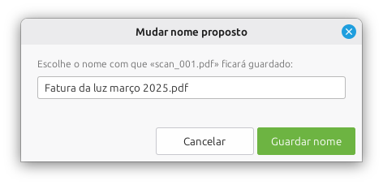

Também podes escrever no campo «MUDAR NOME PROPOSTO» do painel e carregar em «Guardar»; não deixes o campo vazio, porque assim o ficheiro fica com o nome «Sem nome». Se não escreveres a extensão (`.pdf`, `.jpg`…), o Arruma acrescenta-a. Os caracteres que os sistemas não aceitam em nomes (`/ \ : * ? " < > |`) passam a espaços, e se já houver um ficheiro com esse nome no destino, o teu fica com « (2)». A linha passa a dizer «✏️ nome novo» e «escolha tua».

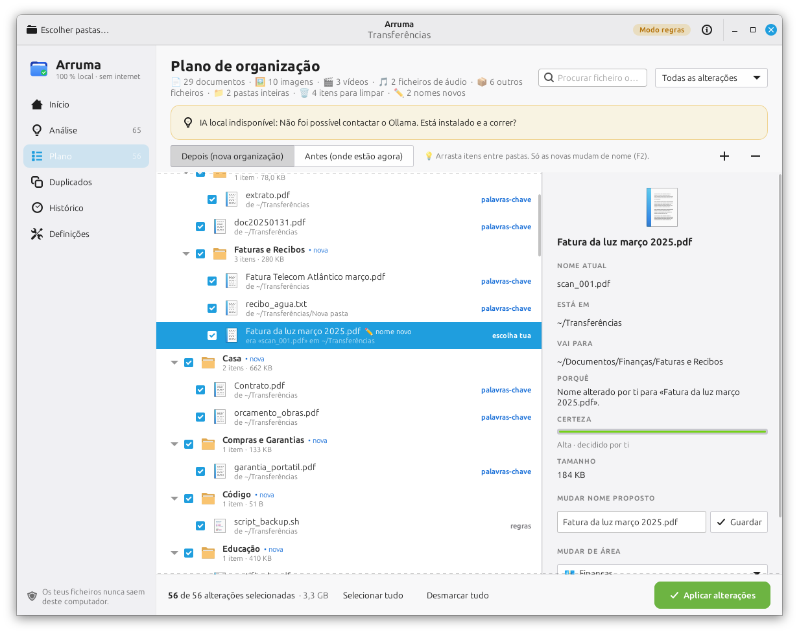

**Mudar o nome de uma pasta sugerida.** Seleciona a pasta na árvore «Depois» e carrega em F2 (ou clique direito → «Mudar nome da pasta… (F2)», ou o campo «MUDAR NOME DA PASTA»). Tudo o que está lá dentro acompanha a pasta. Se escolheres o nome de outra pasta do plano, os conteúdos juntam-se.

**Mudar um documento de área.** No painel, escolhe outra área em «MUDAR DE ÁREA». O documento passa para `Documentos/<nova área>` (a subárea perde-se, porque cada área tem as suas).

**Escolher outro destino.** Carrega em «Outro destino…» no painel (ou clique direito → «Escolher outra pasta de destino…») e escolhe a pasta no seletor «Escolhe o destino».

**Mover uma pasta sugerida para outro sítio.** Seleciona a pasta, carrega em «Mover pasta para outro local…» e escolhe, no seletor «Mover pasta para dentro de…», a pasta onde a queres. Vai com tudo o que o plano lá põe.

Mudar o nome ou mover uma pasta que já existe no disco (sem «• nova») não muda a pasta verdadeira. O que muda é o destino dos ficheiros do plano, que passam a ir para uma pasta nova com esse nome ou nesse sítio; a pasta original e o que já lá estava ficam como estavam.

**Arrastar.** Na árvore «Depois», podes arrastar um ficheiro para outra pasta (ou para cima de outro ficheiro, e vai para a pasta dele) e uma pasta para dentro de outra. Arrastar um item para «Para o Lixo» manda-o para o Lixo; arrastá-lo de lá para uma pasta volta a movê-lo. O grupo «Para o Lixo» aceita também uma pasta inteira, que vai assim toda para o Lixo. Continua a ser recuperável e a poder ser anulada, mas a confirmação vai continuar a falar em «ficheiros temporários», por isso arrasta pastas para lá só de propósito. Não se pode largar nada em «Pastas vazias a remover».

**Menu do botão direito.** Na árvore «Depois», numa pasta: «Mudar nome da pasta… (F2)» e «Mover pasta para outro local…». Num ficheiro ou numa pasta inteira: «Mudar nome proposto… (F2)», «Escolher outra pasta de destino…» e «Mostrar na pasta atual». Num item que vai para o Lixo, só «Mostrar na pasta atual». A árvore «Antes» não tem menu, F2 nem arrastar: aí só usas as caixas, os detalhes e o duplo clique, que abre o ficheiro.

As mudanças que fazes no plano perdem-se, sem aviso, se carregares outra vez em «Criar plano de organização», se fizeres «Analisar novamente» ou se começares outra análise (no Linux, também se usares o clique direito do Nemo com o Arruma aberto). Aplica primeiro.

#### Aplicar o plano

Quando estiveres satisfeito, carrega em «Aplicar alterações» (fica desativado se não houver nada marcado). O Arruma pede confirmação e resume o que vai fazer:


Ao carregares em «Aplicar», o Arruma:

- move primeiro as pastas inteiras, depois os ficheiros, depois manda os temporários para o Lixo (no Windows, a Reciclagem) e por fim remove as pastas vazias;
- nunca substitui um ficheiro: se o destino já tiver um com o mesmo nome, o que chega fica com « (2)», « (3)»…;
- cria as pastas que faltam;
- entre discos diferentes, copia o ficheiro, confirma que a cópia ficou com o mesmo tamanho e só então apaga o original;
- só remove uma pasta vazia se ela continuar vazia;
- não para por causa de um erro: os outros itens continuam.

Nada é apagado de vez. O que vai para o Lixo pode ser recuperado de lá, e tudo pode ser anulado no Histórico.

Durante a arrumação aparece «A arrumar…», com a nota «Não feches o Arruma até terminar.», o ficheiro em curso e um contador.

<!-- aviso: erro conhecido -->
> **Não feches o Arruma enquanto aparece «A arrumar…».** Se o fechares a meio, os ficheiros já mudados ficam nos sítios novos, mas essa arrumação não fica no Histórico e deixas de a poder anular pelo Arruma. Também não comeces outra análise nem procures duplicados até acabar, porque isso interrompe a arrumação a meio. Se precisares mesmo de parar, carrega em «Cancelar»: o Arruma termina o ficheiro em curso e regista o que já fez, que podes anular no Histórico.
<!-- /aviso -->

No fim aparece «Está arrumado!», com o número de alterações aplicadas, e a notificação em baixo com o botão «Anular».

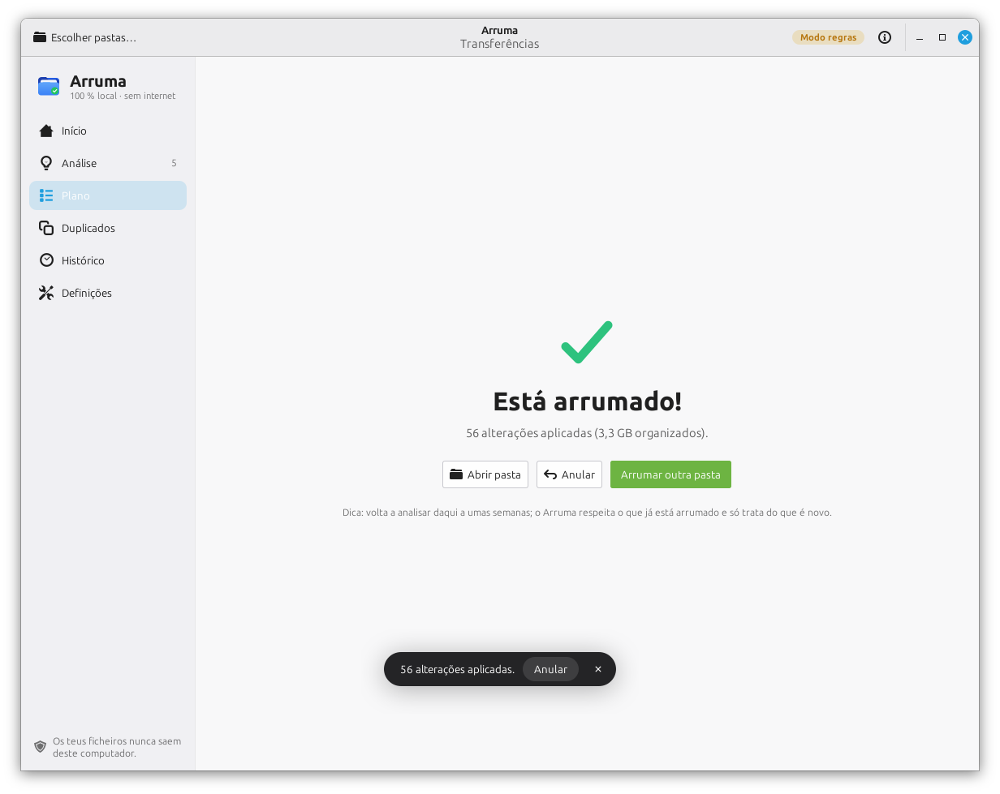

«Abrir pasta» abre a pasta arrumada; quando arrumaste para as pastas pessoais, abre sempre Documentos. «Anular» desfaz esta arrumação. «Arrumar outra pasta» volta ao Início. Como diz a dica, podes voltar a analisar daqui a umas semanas: o Arruma respeita o que já está arrumado e só trata do que é novo.

Se algum item não pôde ser alterado, aparece uma secção «N itens não puderam ser alterados» com o caminho e o motivo de cada um:

| Mensagem | O que quer dizer |
|---|---|
| «O ficheiro já não existe no local original.» | O ficheiro foi mexido depois da análise. Carrega em «Analisar novamente» antes de fazer outro plano. |
| «Já existe» | O destino ficou ocupado entretanto (é raro). |
| «A cópia não ficou igual ao original.» | A cópia para outro disco falhou; o original ficou onde estava. |
| «A pasta já não está vazia.» | Uma pasta vazia recebeu ficheiros entretanto e não foi removida. |
| «Esta unidade não tem Reciclagem; o ficheiro não foi apagado.» | Só no Windows: pens USB e unidades de rede não têm Reciclagem. O ficheiro fica onde estava. |
| «Não foi possível enviar para a Reciclagem (código N).» / «Não foi possível enviar para o Lixo: …» | O sistema recusou (Windows / macOS). |
| Outras mensagens, na língua do sistema | Por exemplo, falta de permissão. |

Se a operação inteira falhar (é raro), aparece «Erro ao arrumar». Nesse caso, o ecrã pode ficar em «A arrumar…»: muda de vista na barra lateral e vê no Histórico o que ficou feito.

### Duplicados

Esta vista procura cópias exatas entre os ficheiros da última análise. Compara o conteúdo, byte a byte, e não o nome: dois ficheiros com nomes diferentes podem ser cópias, e dois com o mesmo nome podem não ser. Não entram as pastas protegidas, os ficheiros ocultos (salvo se ligares a definição) nem os ficheiros vazios.

Sem análise, a vista diz «Procura ficheiros repetidos» e manda-te analisar primeiro uma pasta. Depois de uma análise, carrega em «Procurar duplicados».

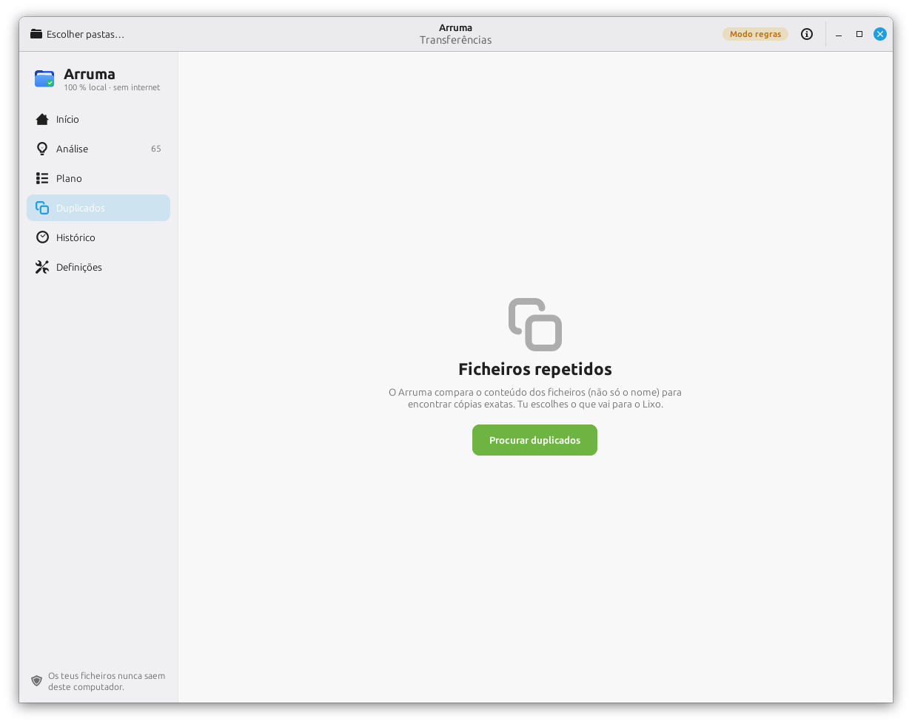

Enquanto procura, aparece «A comparar ficheiros», com um contador e o botão «Cancelar». No fim, os grupos de cópias aparecem ordenados pelo espaço que libertam, com quantas cópias iguais há e o tamanho de cada uma.

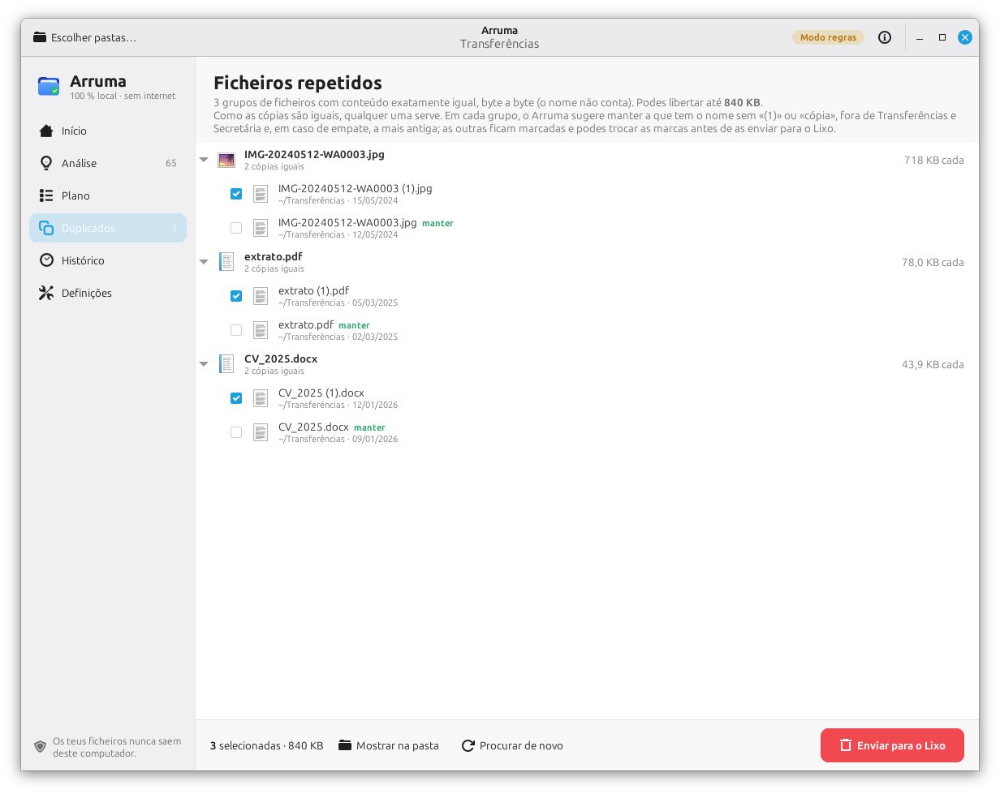

Em cada grupo, o Arruma sugere a cópia a manter, marcada com «manter» a verde: a que tem o nome sem «(1)» ou «cópia», a que está fora de Transferências e da Secretária e, em caso de empate, a mais antiga. **Uma caixa marcada quer dizer que essa cópia vai para o Lixo.** A sugerida vem desmarcada e as outras marcadas, mas podes trocar as marcas. A etiqueta «manter» não muda quando trocas as marcas; o que conta são as caixas. Não é possível marcar todas as cópias de um grupo: o Arruma avisa «Tem de ficar pelo menos uma cópia de cada ficheiro.».

Na barra de baixo vês quantas cópias estão marcadas e quanto espaço libertam. «Mostrar na pasta» mostra a cópia selecionada no gestor de ficheiros e o duplo clique abre-a. «Procurar de novo» repete a procura. «Enviar para o Lixo» (no Windows, «Enviar para a Reciclagem») pede confirmação:


As cópias vão para o Lixo do sistema, de onde as podes recuperar. A operação fica no Histórico como «Remoção de duplicados em «…»», aparece uma notificação com «Anular» e a procura repete-se sozinha.

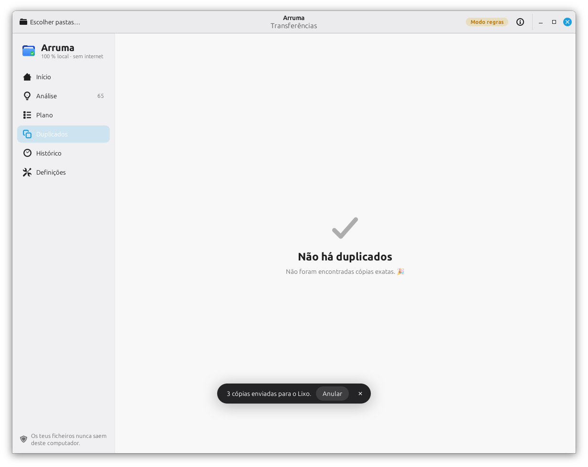

Se uma cópia não puder ir para o Lixo, o Arruma não mostra erro: a cópia continua simplesmente na lista. No Windows, isso acontece com as cópias em pens USB, que não têm Reciclagem. O ecrã «Não há duplicados» não tem botão para procurar outra vez; para isso, volta à Análise e carrega em «Analisar novamente».

### Histórico

Cada arrumação e cada envio de duplicados para o Lixo ficam registados aqui, do mais recente para o mais antigo (até 100). Enquanto não houver nenhum, a vista diz «Ainda não há histórico».

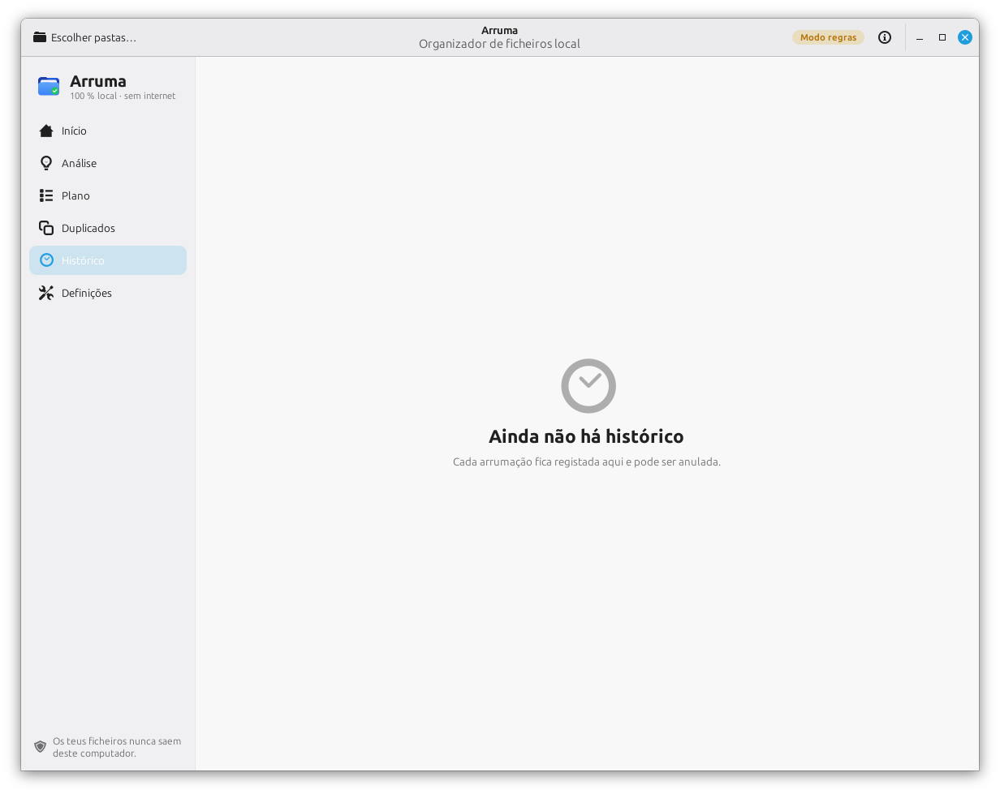

Cada linha diz o que foi feito («Arrumação de «Transferências»» ou «Remoção de duplicados em «Transferências»»), quando («Hoje, 10:21»), quantas alterações e em que pasta. À direita está o botão «Anular».

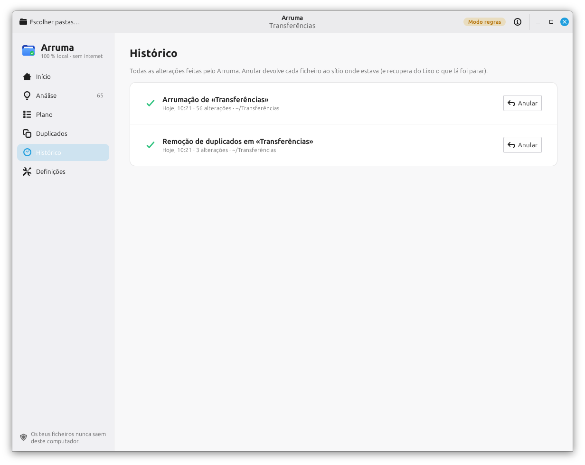

#### Anular

Podes anular uma arrumação em três sítios: na notificação que aparece logo a seguir (durante 7 segundos), no botão «Anular» do ecrã «Está arrumado!» e no Histórico. O Arruma anula logo, sem pedir confirmação.

Anular devolve cada ficheiro e cada pasta ao sítio onde estavam (recriando a pasta original, se for preciso), retira as pastas que a arrumação criou se tiverem ficado vazias, recria as pastas vazias que tinha removido e tira do Lixo o que lá pôs. Nunca substitui nada: se no sítio original já houver um ficheiro com o mesmo nome, esse item fica por anular.

Se correr tudo bem, aparece «Alterações anuladas. Tudo voltou ao local original.» e a linha do Histórico passa a mostrar «Anulada». Depois disso, o Arruma volta a analisar as pastas da análise que tens aberta e mostra a vista Análise.

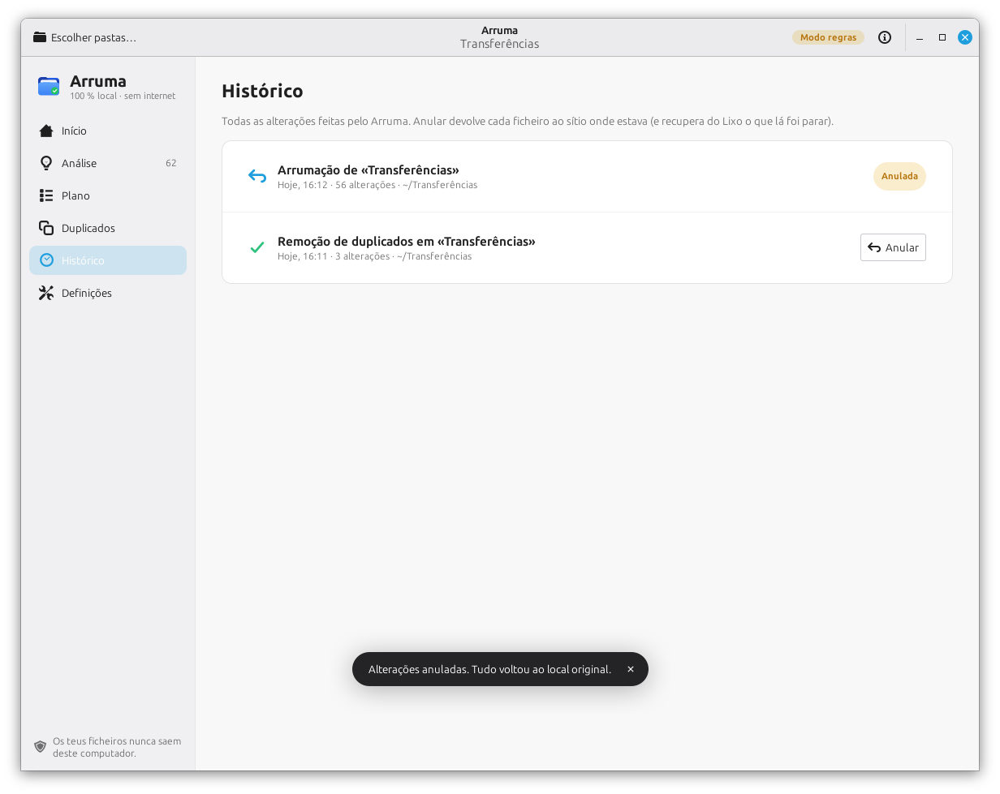

Se alguns itens falharem, aparece «Anulação concluída com avisos», com quantas operações foram revertidas e quantos itens «já tinham sido movidos manualmente». A frase diz sempre «movidos manualmente», seja qual for a causa. A sessão fica «Anulada» na mesma e não há segunda tentativa, por isso esses itens tens de os tratar à mão (os motivos possíveis estão na tabela abaixo). Se quiseres anular várias arrumações, começa pela mais recente: anular uma antiga depois de outras pode falhar nos ficheiros em que as mais recentes mexeram.

| Mensagem | O que quer dizer |
|---|---|
| «O ficheiro já não está onde foi colocado.» | Moveste ou apagaste o ficheiro depois da arrumação. |
| «Já existe um ficheiro no local original.» ou «Já existe» | Há outro ficheiro com o mesmo nome no sítio original. |
| «O ficheiro já não está no Lixo.» (no Windows, «… na Reciclagem.») | O Lixo foi esvaziado ou o ficheiro já foi recuperado. |
| «O macOS não deixou tirar o ficheiro do Lixo. Usa «Pôr de volta» no Finder.» | Só no macOS: recupera-o tu no Lixo, com «Pôr de volta». |

O histórico vive num ficheiro (`arruma.db`, ver [Onde ficam os teus dados](#onde-ficam-os-teus-dados)). Se o apagares, deixas de poder anular as arrumações antigas.

### Definições

Tudo se guarda sozinho, assim que mudas; não há botão para guardar. As mudanças contam a partir do próximo plano: muda uma definição, volta à Análise e carrega outra vez em «Criar plano de organização», sem precisar de analisar de novo. As exceções são «Incluir ficheiros e pastas ocultos» e «Pastas a ignorar sempre», que só contam na análise seguinte.

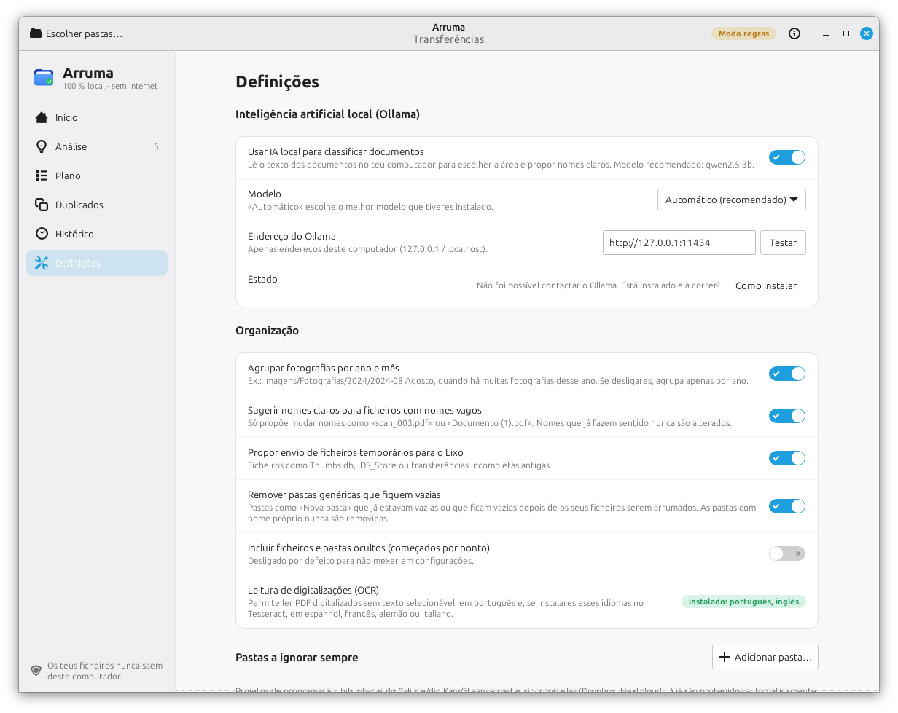

**Inteligência artificial local (Ollama)**

| Definição | O que faz |
|---|---|
| «Usar IA local para classificar documentos» (ligada) | Lê o texto dos documentos para escolher a área e propor nomes claros. Desligada, o Arruma usa só regras e palavras-chave. |
| «Modelo» («Automático (recomendado)») | Escolhe o melhor modelo que tiveres instalado no Ollama. Podes escolher outro na lista. |
| «Endereço do Ollama» (`http://127.0.0.1:11434`) | Só aceita endereços deste computador. Guarda-se ao carregar em Enter; «Testar» volta a verificar. Vazio, volta ao endereço de origem. |
| «Estado» | Diz se o Arruma está ligado ao Ollama e que modelo usa, ou qual é o problema. «Como instalar» mostra os passos. |

**Organização**

| Definição | O que faz |
|---|---|
| «Agrupar fotografias por ano e mês» (ligada) | Cria pastas de mês (`Imagens/Fotografias/2024/2024-08 Agosto`) quando há 40 ou mais fotografias desse ano. Desligada, agrupa só por ano. |
| «Sugerir nomes claros para ficheiros com nomes vagos» (ligada) | Propõe nomes para ficheiros como «scan_003.pdf». Nos documentos, só funciona com a IA; na música, usa as etiquetas. |
| «Propor envio de ficheiros temporários para o Lixo» (ligada) | Põe os restos no grupo «Para o Lixo» do plano. Desligada, ficam onde estão. |
| «Remover pastas genéricas que fiquem vazias» (ligada) | Apaga pastas como «Nova pasta» depois de a arrumação as esvaziar. Não afeta as pastas que já estavam vazias, que continuam a aparecer no plano. |
| «Incluir ficheiros e pastas ocultos (começados por ponto)» (desligada) | Inclui os ficheiros ocultos na análise. No Windows e no macOS abrange também os que o sistema marca como ocultos. Convém deixá-la desligada, para não mexer nos ficheiros onde os programas guardam as suas definições. |
| «Leitura de digitalizações (OCR)» | Só informa: «instalado», com os idiomas encontrados, ou «não instalado», com a dica para o teu sistema. Ver [Leitura de digitalizações](#leitura-de-digitalizações). |

**Pastas a ignorar sempre**

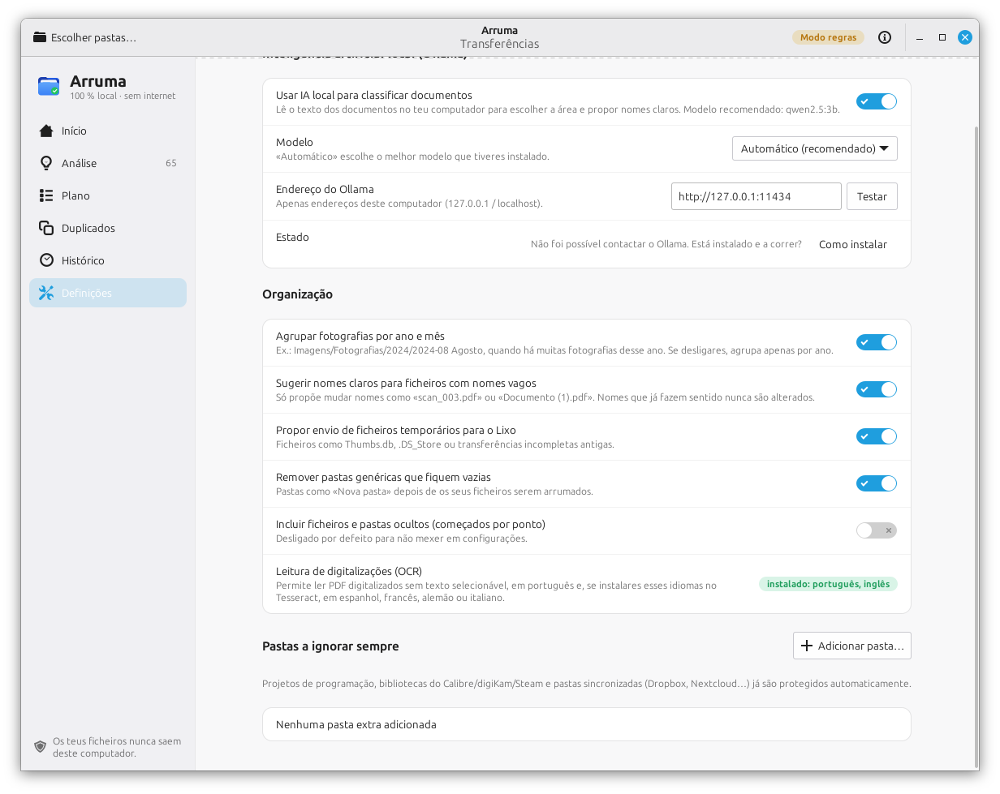

«Adicionar pasta…» acrescenta uma pasta que o Arruma nunca deve ler nem alterar. Na análise seguinte, essa pasta e tudo o que tem dentro aparecem como protegidos («excluída nas definições»). O botão do caixote, à direita de cada pasta, deixa de a ignorar. Projetos de programação, bibliotecas e pastas sincronizadas já são protegidos sem precisares de os acrescentar. Atenção: se escolheres diretamente uma destas pastas para analisar, ela é analisada e arrumada na mesma.

### Acerca

O botão com o «i» na barra de cima («Acerca do Arruma») mostra a versão, a licença (GNU General Public License, versão 3 ou posterior) e a ligação «Código-fonte no GitHub». «Créditos» mostra o autor e «Licença» o texto completo da licença. No Linux, a janela chama-se «Sobre Arruma». No Windows e no macOS há também o botão «Licenças de terceiros», que abre a pasta com as licenças dos componentes de outros autores que o Arruma traz.

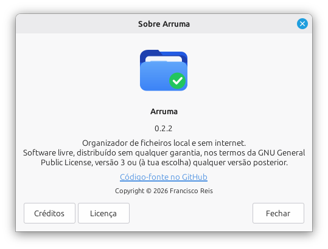

## IA local e leitura de digitalizações (opcionais)

### IA local

Sem IA, o Arruma decide com regras, metadados (datas das fotografias, etiquetas da música) e palavras-chave. Com a IA local, lê o texto de cada documento para escolher a área e propõe nomes claros para os que têm nomes vagos. A IA corre no teu computador, através de um programa chamado Ollama, e o Arruma recusa ligar-se a uma IA que esteja noutro computador. Só precisas de internet uma vez, para instalar o Ollama e descarregar o modelo recomendado, `qwen2.5:3b` (cerca de 2 GB).

No Início, o botão «Como ativar» abre a janela «Como ativar a IA local (Ollama)» com os passos para o teu sistema e o botão «Copiar comandos».

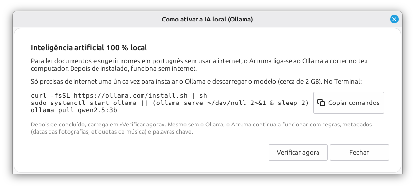

**Linux.** No Terminal:

```bash
curl -fsSL https://ollama.com/install.sh | sh
sudo systemctl start ollama || (ollama serve >/dev/null 2>&1 & sleep 2)
ollama pull qwen2.5:3b
```

O primeiro comando pede a palavra-passe e escreve as mensagens em inglês. `WARNING: No NVIDIA/AMD GPU detected. Ollama will run in CPU-only mode.` é normal num computador sem placa gráfica dedicada; a instalação acaba com a linha `>>> Install complete. Run "ollama" from the command line.`. Se aparecer um erro a pedir o `zstd`, corre `sudo apt-get install zstd` e repete; se o Terminal disser que o `curl` não existe, corre `sudo apt install curl`. O último comando descarrega o modelo e mostra o progresso.

**Windows.** Descarrega e instala o Ollama a partir de <https://ollama.com/download/windows> (a janela do Arruma tem o botão «Abrir a página de transferência do Ollama»). Não precisa de permissões de administrador e pede o Windows 10 22H2 ou mais recente. Depois abre o PowerShell e descarrega o modelo:

```powershell
ollama pull qwen2.5:3b
```

**macOS.** Descarrega a aplicação Ollama em <https://ollama.com/download/mac>, arrasta-a para a pasta Aplicações e abre-a uma vez. O macOS pergunta se tens a certeza de que a queres abrir, porque veio da internet, e o Ollama pode pedir a palavra-passe para que o comando `ollama` fique disponível no Terminal. Depois, no Terminal:

```bash
ollama pull qwen2.5:3b
```

No fim, carrega em «Verificar agora». A resposta não aparece na própria janela: vê-se, por trás dela, no cartão do Início e no indicador da barra de cima. Fecha a janela com «Fechar».

| Cartão do Início | Indicador na barra de cima | O que quer dizer |
|---|---|---|
| «a verificar…» | «IA local» | O Arruma está a ver se o Ollama responde. Se o Ollama estiver instalado mas parado, tenta arrancá-lo e espera até cerca de 8 segundos. |
| «ativa» | «IA local: qwen2.5:3b» | A IA está pronta. |
| «não encontrada» | «Modo regras» | O Ollama não está instalado, está parado, ou não tem nenhum modelo («O Ollama está a correr, mas ainda não tem nenhum modelo instalado. Executa: ollama pull qwen2.5:3b»). O Arruma funciona na mesma, com regras e palavras-chave. |
| «desligada» | «IA desligada» | Desligaste a IA nas Definições. |

Quando ligas ou desligas «Usar IA local para classificar documentos» nas Definições, o cartão do Início muda logo, mas o indicador da barra de cima só muda depois de carregares em «Testar» ou «Verificar novamente», ou de reabrires o Arruma. E, mesmo com a IA desligada, ao abrir o Arruma verifica o Ollama e, se ele estiver instalado mas parado, arranca-o em segundo plano.

A IA corre no processador e demora: para teres uma ideia, num servidor sem placa gráfica levou 7 a 8 segundos por documento. Enquanto prepara o plano, o Arruma mostra o tempo que falta e o botão «Continuar sem IA». Os resultados ficam guardados, por isso voltar a planear os mesmos ficheiros com o mesmo modelo é muito mais rápido.

Outras mensagens que podes ver no estado da IA: «Por privacidade, o Arruma só usa uma IA a correr neste computador (localhost / 127.0.0.1).» (escreveste o endereço de outro computador), «Endereço inválido.», «O Ollama respondeu com erro …» e «Resposta inválida do Ollama.».

### Leitura de digitalizações

A leitura de digitalizações (OCR) permite ao Arruma ler PDF digitalizados, que não têm texto selecionável, para os classificar como os outros documentos. Lê sempre em português; se o texto lido mostrar que o documento está noutro idioma que tenhas instalado (espanhol, francês, alemão, italiano ou inglês), lê-o também nesse idioma. Só é usada em PDF quase sem texto e só lê a primeira página. Fotografias de documentos em JPG ou PNG não são lidas.

O Arruma usa o programa Tesseract. Depois de o instalares, fecha e volta a abrir o Arruma: o estado só é lido quando ele abre. Em Definições, a linha «Leitura de digitalizações (OCR)» passa a dizer «instalado», com os idiomas encontrados.

**Linux.** No Ubuntu, o Tesseract em português vem com o pacote do Arruma; no Linux Mint pode não vir. Para o instalar, e outros idiomas se precisares:

```bash
sudo apt install tesseract-ocr-por
sudo apt install tesseract-ocr-spa tesseract-ocr-fra tesseract-ocr-deu tesseract-ocr-ita
```

**Windows.** Instala o Tesseract para Windows feito pela biblioteca da Universidade de Mannheim, a partir de <https://github.com/UB-Mannheim/tesseract/wiki> (o ficheiro chama-se `tesseract-ocr-w64-setup-….exe`). O instalador está em inglês; na lista de idiomas, escolhe o português e os outros de que precisares. Instala na pasta que ele propõe, ou numa pasta nova, porque o desinstalador do Tesseract apaga a pasta inteira.

**macOS.** Precisas do Homebrew. Se ainda não o tens, instala-o no Terminal (pede a palavra-passe de administrador):

```bash
/bin/bash -c "$(curl -fsSL https://raw.githubusercontent.com/Homebrew/install/HEAD/install.sh)"
```

Num Mac com processador Apple, o Homebrew deve mostrar no fim, em inglês, uns comandos para o pôr a funcionar no Terminal; copia-os e corre-os. Depois instala o Tesseract com todos os idiomas:

```bash
brew install tesseract tesseract-lang poppler
```

## Clique direito nas pastas

### Linux (Nemo)

No gestor de ficheiros do Linux Mint, seleciona uma ou mais pastas, clica com o botão direito e escolhe «Arrumar com o Arruma». O Arruma abre e começa logo a análise; com várias pastas, analisa-as todas juntas. A opção só aparece com pastas selecionadas: não aparece no fundo de uma pasta aberta nem em ficheiros. Se não aparecer logo a seguir à instalação, fecha e volta a abrir o gestor de ficheiros.

No Linux, o Arruma tem uma só janela. Se já estiver aberto, o pedido do Nemo vai para essa janela e começa uma análise nova, que substitui a análise e o plano que lá estavam, sem perguntar. Aplica ou abandona o plano antes de usares o clique direito.

### Windows (Explorador de Ficheiros)

Se deixaste marcada a tarefa «Acrescentar «Arrumar com o Arruma» ao menu do botão direito das pastas» durante a instalação, tens duas opções:

- clique direito numa pasta → «Arrumar com o Arruma»;
- clique direito num espaço vazio dentro de uma pasta aberta → «Arrumar esta pasta com o Arruma».

No Windows 11, estas opções estão em «Mostrar mais opções», no fundo do menu do botão direito. Cada uma abre uma janela nova do Arruma. Para acrescentar ou tirar estas opções depois, desinstala o Arruma e volta a instalá-lo, escolhendo as tarefas que queres.

### macOS

No macOS não há opção no clique direito do Finder. Abre o Arruma pela pasta Aplicações ou pelo Launchpad e escolhe as pastas lá dentro.

### Pelo Terminal

Também podes abrir o Arruma com pastas já escolhidas. No Linux:

```bash
arruma ~/Transferências ~/Secretária
```

O Arruma abre e analisa as pastas indicadas, todas juntas (o que não for pasta é ignorado). `arruma /` analisa o computador todo e `arruma --version` mostra a versão sem abrir a janela. Usa sempre caminhos completos. No Windows, o programa é o `Arruma.exe` da pasta de instalação (normalmente `%LOCALAPPDATA%\Programs\Arruma`); no macOS, `/Applications/Arruma.app/Contents/MacOS/Arruma`.

## Problemas frequentes

### Linux

**O ícone do Arruma aparece como um quadrado vazio no menu ou na barra de tarefas.** Acontece quando uma cópia antiga, instalada com o `instalar.sh`, foi apagada à mão: a lista de ícones guardada na tua pasta pessoal continua a apontar para um ícone que já não existe. O pacote 0.2.2 refaz essa lista quando é instalado. Se o quadrado continuar, refá-la tu no Terminal:

```bash
gtk-update-icon-cache -f -t ~/.local/share/icons/hicolor
```

Depois fecha e volta a abrir o Arruma. Se o menu continuar com o quadrado, termina a sessão e volta a entrar.

**O `instalar.sh` responde «O pacote arruma 0.2.2 já está instalado no sistema.».** Tens o pacote `.deb` instalado, e o `instalar.sh` nunca se instala por cima dele. Para atualizar, instala o `.deb` mais recente. Se a linha seguinte disser «Ainda há uma cópia antiga na pasta pessoal; retira-a com ./instalar.sh --remover.», corre esse comando. Se disser que a cópia na pasta pessoal é mais recente do que o pacote e que é essa que se abre, escolhe uma das duas: ou retiras o pacote (`sudo apt remove arruma`) e continuas com o `instalar.sh`, ou retiras a cópia (`./instalar.sh --remover`) e instalas um `.deb` recente.

**O Arruma não abre depois do `instalar.sh`.** O `instalar.sh` não instala as peças de que o Arruma depende. Instala-as (precisa da palavra-passe de administrador):

```bash
sudo apt install python3-gi python3-gi-cairo gir1.2-gtk-3.0 poppler-utils
```

**O Terminal diz `E: Ficheiro não suportado …` ou `E: Não foi possível encontrar o pacote …`.** No primeiro caso, o Terminal não está na pasta do ficheiro (escreve `cd ~/Transferências`); no segundo, faltou o `./` antes do nome. Ver [No Terminal](#no-terminal).

**«Arrumar com o Arruma» não aparece no clique direito do Nemo.** Seleciona uma pasta (não um ficheiro, nem o fundo de uma pasta aberta). Se mesmo assim não aparecer, fecha todas as janelas do gestor de ficheiros e abre-o de novo.

### Windows

**O Windows não deixa abrir o instalador.** Se aparecer «O Windows protegeu o seu PC», carrega em «Mais informações» e depois em «Executar mesmo assim». Se, no Windows 11, o instalador for bloqueado sem te dar opção para continuar, é provável que seja o [Controlo Inteligente de Aplicações](#controlo-inteligente-de-aplicações-windows-11).

**Não encontro «Arrumar com o Arruma» no clique direito.** No Windows 11, está em «Mostrar mais opções». Se não estiver lá, a tarefa ficou desmarcada na instalação: desinstala e volta a instalar, deixando-a marcada.

**O instalador diz que o Arruma já está instalado e fecha.** Já tens esta versão. Para reinstalar, desinstala primeiro.

**Aparece «Esta unidade não tem Reciclagem; o ficheiro não foi apagado.».** As pens USB e as unidades de rede não têm Reciclagem, por isso o Arruma não manda para lá nada dessas unidades. O ficheiro fica onde estava; se o quiseres apagar, fá-lo tu.

### macOS

**O macOS não deixa abrir o instalador.** Segue os passos 2 a 5 de [Instalar no macOS](#macos). Se o botão «Abrir» já não estiver em Privacidade e Segurança, passou mais de uma hora: tenta abrir o instalador outra vez e o botão volta.

**O instalador diz «Este instalador é para Macs com processador Intel».** O teu Mac tem processador Apple. Descarrega o instalador `apple-silicon`.

**O instalador diz «A instalação falhou».** O mais provável é o Arruma estar aberto noutra conta do Mac. Fecha-o nessa conta e tenta de novo. Para ver o motivo exato, corre no Terminal `grep Arruma /var/log/install.log`.

**O macOS não deixa abrir o próprio Arruma.** Não é o esperado, porque foi o Instalador que o copiou para Aplicações. Se acontecer, faz como para o instalador: tenta abri-lo, vai a Definições do Sistema → Privacidade e Segurança e carrega em «Abrir».

**O Arruma não consegue ler a Secretária, os Documentos ou as Transferências.** Provavelmente carregaste em «Não permitir» quando o macOS perguntou. A autorização muda-se em Definições do Sistema → Privacidade e Segurança.

### Em qualquer sistema

**A IA aparece como «não encontrada».** O Ollama não está instalado, está parado ou não tem modelo. Segue os passos de [IA local](#ia-local). No Linux, para o pôr a correr: `sudo systemctl start ollama`. Se só faltar o modelo: `ollama pull qwen2.5:3b`. Depois carrega no botão «Verificar novamente» do cartão do Início.

**Instalei o Tesseract mas o OCR continua «não instalado».** Fecha e volta a abrir o Arruma: o estado só é lido quando ele abre.

**Um plano novo dá erros «O ficheiro já não existe no local original.».** A análise ficou desatualizada, porque os ficheiros mudaram de sítio depois dela (por exemplo, depois de aplicares um plano). Carrega em «Analisar novamente» e cria o plano outra vez.

**Aparece «Não é possível escolher esta pasta».** É uma pasta do sistema, uma pasta onde os programas guardam as suas definições, uma pasta que já não existe ou uma pasta em que não podes escrever. Escolhe outra.

**Aparece «Anulação concluída com avisos».** Alguns ficheiros não voltaram ao sítio: ou já não estavam onde o Arruma os pôs, ou o sítio original tem outro ficheiro com o mesmo nome, ou saíram do Lixo. Procura-os e move-os à mão. Ver [Anular](#anular).

<!-- aviso: erro conhecido -->
**Fechei o Arruma enquanto arrumava.** Os ficheiros que já tinham mudado ficaram nos sítios novos, mas essa arrumação não aparece no Histórico e não a podes anular pelo Arruma. Abre o Arruma, analisa outra vez a pasta para veres como ficou e, se for preciso, move os ficheiros à mão.
<!-- /aviso -->

## Onde ficam os teus dados

O Arruma guarda as definições num ficheiro (`definicoes.json`) e o histórico num outro (`arruma.db`), que serve para anular as arrumações e guarda também os resultados da IA. Nenhuma atualização ou desinstalação os apaga.

| Sistema | Definições | Histórico |
|---|---|---|
| Linux | `~/.config/arruma/` | `~/.local/share/arruma/` |
| Windows (instalado ou portátil) | `%APPDATA%\Arruma\` (ou seja, `C:\Users\<o teu nome>\AppData\Roaming\Arruma\`) | a mesma pasta |
| macOS | `~/Library/Application Support/Arruma/` | a mesma pasta |

As pastas `~/.config` e `~/.local`, no Linux, e `AppData`, no Windows, estão escondidas no gestor de ficheiros. No macOS, a pasta Biblioteca (`~/Library`) também; para lá chegares, no Finder, usa o menu Ir → «Ir para a pasta…» e escreve `~/Library/Application Support/Arruma` (os nomes dos menus podem variar ligeiramente).

Para apagar tudo, apaga estas pastas à mão depois de desinstalares. Sem o `arruma.db`, deixas de poder anular as arrumações antigas.

O próprio programa fica, no Linux, em `/usr/lib/arruma` (pacote) ou em `~/.local/share/arruma-app` (`instalar.sh`); no Windows, em `%LOCALAPPDATA%\Programs\Arruma` (só para ti) ou em `C:\Program Files\Arruma` (para todos); no macOS, em `/Applications/Arruma.app`.

Se encontrares um problema que não esteja neste manual, ou uma mensagem diferente das que aqui aparecem, descreve-o na página de problemas do projeto: <https://github.com/franciscovazquezreis/Arruma/issues>.
